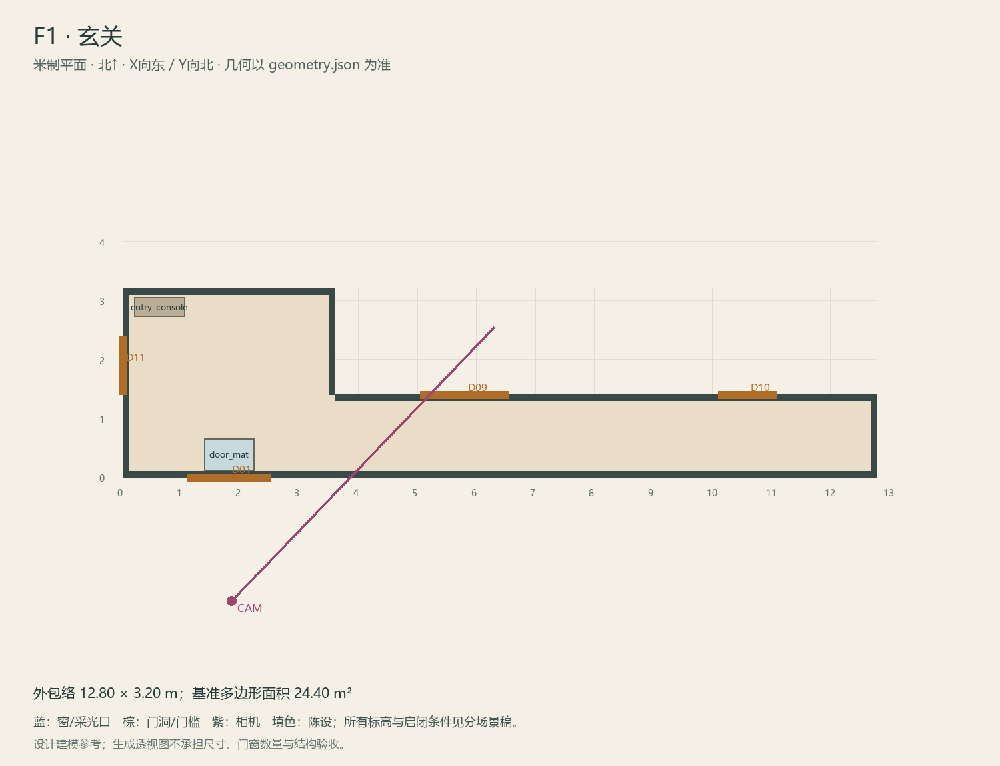

# F1 · 玄关

ASSET-069 · 一层 · 第一夜建模参考，尚非已建成模型。

此节点暂无独立透视参考；以米制图和文字规格为准。

## 场景叙事与镜头

偏置的小门厅，浅灰水磨石与深木门套，现代电子锁和旧门框并置。向客厅的视线清楚，地面接缝是第一眼重点。

事件：A01/A10/A20/A47/A49。必须可读：正门两侧连续砖缝；门边R2抽屉；转去S与F8的路线不可被柜体挡住。

推荐构图：从院门内侧看客厅方向；补一格门框/砖缝近景。 透视图表达材质和氛围，下面的坐标与正交图控制建模。

## 精确结构

世界坐标 X 东/Y 北/Z 上，单位米。地坪 Z=0.0；净高参考 3.2；基准包络 12.80×3.20；多边形面积 24.40㎡。面积为基准线围合面积，净面积须按 geometry.json 的墙厚约定扣除。

基准顶点：`[[0, 0], [12.8, 0], [12.8, 1.4], [3.6, 1.4], [3.6, 3.2], [0, 3.2]]`。房间源对象原点：`[0, 3.2, 0.0]`；禁止整体重置 Location。

门洞：

| 编号 | 相邻节点 | 门槛中心 XYZ | 净宽×高 | 沿轴 | 门禁 |
| --- | --- | --- | --- | --- | --- |
| D01 | O1 | [1.8, 0, 0] | 1.4×2.4 | X | order_unlocked |
| D09 | F2 | [5.8, 1.4, 0] | 1.5×2.5 | X | always_open |
| D10 | F8 | [10.6, 1.4, 0] | 1.0×2.1 | X | always_open |
| D11 | S | [0, 1.9, 0] | 1.0×2.2 | Y | always_open |

窗/开口：

无独立外窗；不允许从透视图复制新增窗洞。

## 陈设与观察位

| 资产套件 | 尺寸 W/D/H | 底面中心 XYZ | Z旋转° | 碰撞 | 说明 |
| --- | --- | --- | --- | --- | --- |
| entry_console | [0.85, 0.32, 0.9] | [0.62, 2.89, 0] | 0 | True | 西墙收纳台，R2抽屉朝东；不侵入通往S的门前。 |
| door_mat | [0.85, 0.55, 0.012] | [1.8, 0.38, 0] | 0 | False | 正门内侧；门槛砖缝不被遮住。 |

相机：`{"position": [1.85, -2.1, 1.62], "target": [6.3, 2.55, 1.48], "lens_mm": 27}`。

通行检查：从正门至F2、F8与S的主线净宽均不小于0.90m。

## 状态与制作分件

M：干净门垫与电子锁；W：旧插销与花砖；G：仅门框和门外地面错接。

室内：灰米矿物抹灰、深棕木窗及踢脚、保养木地板；现代修补克制保留。 精确色值、材质粗糙度、贴图复用规则见 [visual-bible.md](../visual-bible.md)。

静态墙地顶、门窗框和普通陈设分集合制作；可动门扇、窗帘、锁、开关、抽屉、纸张、电话及手镜必须独立。关键道具尺寸、状态和操作见 [interaction-specs.md](../interaction-specs.md)。

Blender 保留高精度可编辑源，倒角按真实尺度制作，禁止把贴图阴影烘成唯一细节。优化导出单独生成；面数/贴图预算由实机性能复核，不能以占位模型冒充最终资产。完整交接见 [blender-handoff.md](../blender-handoff.md)。

## 此场景验收

- 逐一核对本页门窗与 geometry.json；检查墙厚、门扇扫掠区与上方梁底净空。
- 从相机位确认“必须可读”的道具与退路都可辨，普通装饰不得遮挡。
- 核对 M/W/G 只变化本页批准的局部；不引入额外通道。
- 建模完成后另验 UV、法线、贴图嵌入、碰撞与 目标引擎 运行；当前包不提供这些尚未发生的通过证据。

[返回总览](../index.html)
