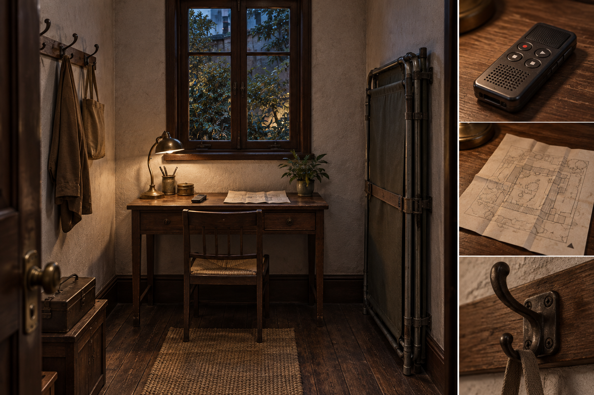
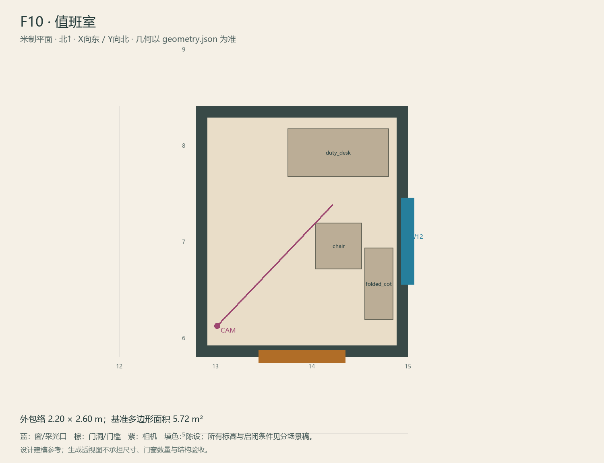

# F10 · 值班室

ASSET-078 · 一层 · 第一夜建模参考，尚非已建成模型。

## 场景叙事与镜头

由旧看管人小房改成值班室；一张窄桌、一把椅子、小文件架，折叠床靠墙收起而非占据中间。

事件：A35/D7/I3。必须可读：林远录音机和外圈图在桌上，播放指示/纸张近看清晰；这里不再放钥匙盒。

推荐构图：门内视角看桌面录音机；补设备与地图近景。 透视图表达材质和氛围，下面的坐标与正交图控制建模。

## 精确结构

世界坐标 X 东/Y 北/Z 上，单位米。地坪 Z=0.0；净高参考 3.0；基准包络 2.20×2.60；多边形面积 5.72㎡。面积为基准线围合面积，净面积须按 geometry.json 的墙厚约定扣除。

基准顶点：`[[12.8, 5.8], [15.0, 5.8], [15.0, 8.4], [12.8, 8.4]]`。房间源对象原点：`[12.8, 8.4, 0.0]`；禁止整体重置 Location。

门洞：

| 编号 | 相邻节点 | 门槛中心 XYZ | 净宽×高 | 沿轴 | 门禁 |
| --- | --- | --- | --- | --- | --- |
| D19 | F9 | [13.9, 5.8, 0] | 0.9×2.0 | X | I2 |

窗/开口：

| 编号 | 中心 XYZ | 宽×高 | 窗台 | 沿轴 | 视线目标 |
| --- | --- | --- | --- | --- | --- |
| W12 | [15.0, 7.0, 1.475] | 0.9×1.45 | 0.75 | Y | O5 |

## 陈设与观察位

| 资产套件 | 尺寸 W/D/H | 底面中心 XYZ | Z旋转° | 碰撞 | 说明 |
| --- | --- | --- | --- | --- | --- |
| duty_desk | [1.05, 0.5, 0.75] | [14.28, 7.92, 0] | 0 | True | 北墙值班桌，I3和外圈图在桌面。 |
| chair | [0.48, 0.48, 0.85] | [14.28, 6.95, 0] | 0 | True | 朝北，留门口回转。 |
| folded_cot | [0.75, 0.3, 1.75] | [14.7, 6.55, 0] | 90 | True | 东墙竖收，不形成第二床位。 |

相机：`{"position": [13.02, 6.12, 1.56], "target": [14.22, 7.38, 1.05], "lens_mm": 32}`。

通行检查：从F9门至桌前至少0.95m；录音机前留0.75m站位。

## 状态与制作分件

M；旧身份靠保留挂钩和小窗表示，不加第二套卧室。

室内：灰米矿物抹灰、深棕木窗及踢脚、保养木地板；现代修补克制保留。 精确色值、材质粗糙度、贴图复用规则见 [visual-bible.md](../visual-bible.md)。

静态墙地顶、门窗框和普通陈设分集合制作；可动门扇、窗帘、锁、开关、抽屉、纸张、电话及手镜必须独立。关键道具尺寸、状态和操作见 [interaction-specs.md](../interaction-specs.md)。

Blender 保留高精度可编辑源，倒角按真实尺度制作，禁止把贴图阴影烘成唯一细节。优化导出单独生成；面数/贴图预算由实机性能复核，不能以占位模型冒充最终资产。完整交接见 [blender-handoff.md](../blender-handoff.md)。

## 此场景验收

- 逐一核对本页门窗与 geometry.json；检查墙厚、门扇扫掠区与上方梁底净空。
- 从相机位确认“必须可读”的道具与退路都可辨，普通装饰不得遮挡。
- 核对 M/W/G 只变化本页批准的局部；不引入额外通道。
- 建模完成后另验 UV、法线、贴图嵌入、碰撞与 目标引擎 运行；当前包不提供这些尚未发生的通过证据。

[返回总览](../index.html)
