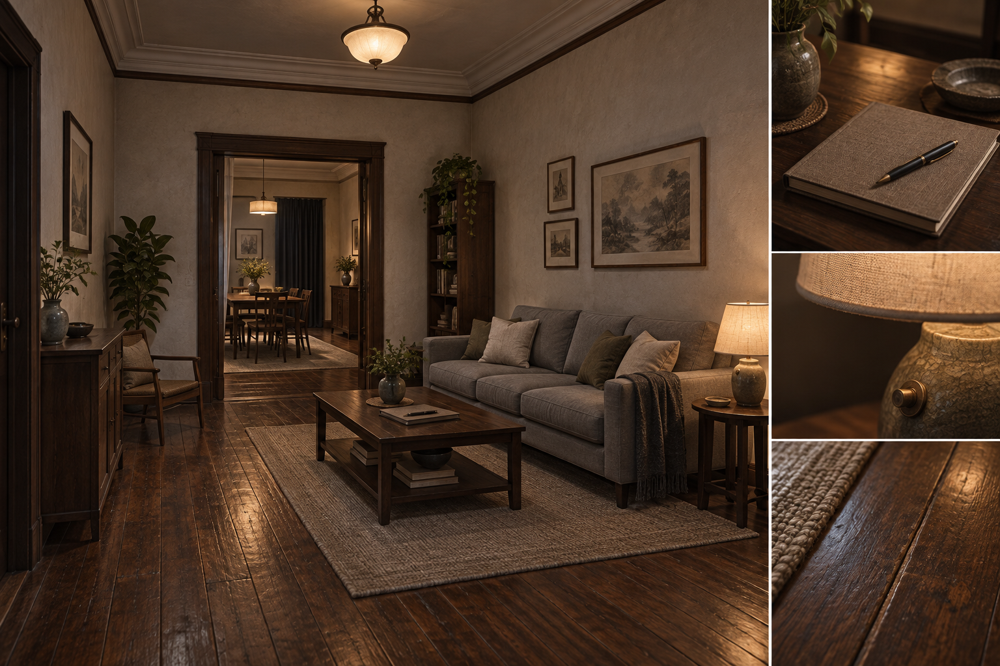
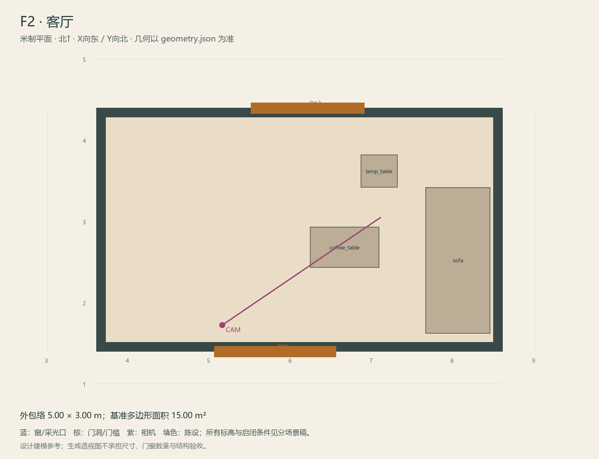

# F2 · 客厅

ASSET-070 · 一层 · 第一夜建模参考，尚非已建成模型。

## 场景叙事与镜头

温和的灰米色墙、保养过的木地板、两人布沙发和小茶几。留出停留、看纸和回望玄关的位置；舒适但不做豪华酒店。

事件：A02/A11/A19/A42–A48。必须可读：入住册D0在桌面；台灯朝F3窗线可形成指定漏光；沙发等待点、F1入口必须一眼可辨。

推荐构图：从玄关一侧看沙发、册页和餐厅门；补灯具近景。 透视图表达材质和氛围，下面的坐标与正交图控制建模。

## 精确结构

世界坐标 X 东/Y 北/Z 上，单位米。地坪 Z=0.0；净高参考 3.2；基准包络 5.00×3.00；多边形面积 15.00㎡。面积为基准线围合面积，净面积须按 geometry.json 的墙厚约定扣除。

基准顶点：`[[3.6, 1.4], [8.6, 1.4], [8.6, 4.4], [3.6, 4.4]]`。房间源对象原点：`[3.6, 4.4, 0.0]`；禁止整体重置 Location。

门洞：

| 编号 | 相邻节点 | 门槛中心 XYZ | 净宽×高 | 沿轴 | 门禁 |
| --- | --- | --- | --- | --- | --- |
| D09 | F1 | [5.8, 1.4, 0] | 1.5×2.5 | X | always_open |
| D12 | F3 | [6.2, 4.4, 0] | 1.4×2.4 | X | always_open |

窗/开口：

无独立外窗；不允许从透视图复制新增窗洞。

## 陈设与观察位

| 资产套件 | 尺寸 W/D/H | 底面中心 XYZ | Z旋转° | 碰撞 | 说明 |
| --- | --- | --- | --- | --- | --- |
| sofa | [1.8, 0.8, 0.85] | [8.05, 2.52, 0] | 90 | True | 东墙双人沙发，朝西；避开F3门洞。 |
| coffee_table | [0.85, 0.5, 0.42] | [6.65, 2.68, 0] | 0 | True | 可绕行，册页放桌面。 |
| lamp_table | [0.45, 0.4, 0.65] | [7.08, 3.62, 0] | 0 | True | 灯光到餐厅窗线穿过D12净洞，不穿实墙；坐垫与纸张保持原位。 |

相机：`{"position": [5.15, 1.72, 1.58], "target": [7.1, 3.05, 1.05], "lens_mm": 30}`。

通行检查：F1-F3直线通路沿西侧保留1.20m；沙发等待点前留1.35m。

## 状态与制作分件

M：布沙发与现代册页；W：局部旧布罩、旧灯与纸张替换，保留同一沙发体块；G不改变客厅结构。

室内：灰米矿物抹灰、深棕木窗及踢脚、保养木地板；现代修补克制保留。 精确色值、材质粗糙度、贴图复用规则见 [visual-bible.md](../visual-bible.md)。

静态墙地顶、门窗框和普通陈设分集合制作；可动门扇、窗帘、锁、开关、抽屉、纸张、电话及手镜必须独立。关键道具尺寸、状态和操作见 [interaction-specs.md](../interaction-specs.md)。

Blender 保留高精度可编辑源，倒角按真实尺度制作，禁止把贴图阴影烘成唯一细节。优化导出单独生成；面数/贴图预算由实机性能复核，不能以占位模型冒充最终资产。完整交接见 [blender-handoff.md](../blender-handoff.md)。

## 此场景验收

- 逐一核对本页门窗与 geometry.json；检查墙厚、门扇扫掠区与上方梁底净空。
- 从相机位确认“必须可读”的道具与退路都可辨，普通装饰不得遮挡。
- 核对 M/W/G 只变化本页批准的局部；不引入额外通道。
- 建模完成后另验 UV、法线、贴图嵌入、碰撞与 目标引擎 运行；当前包不提供这些尚未发生的通过证据。

[返回总览](../index.html)
