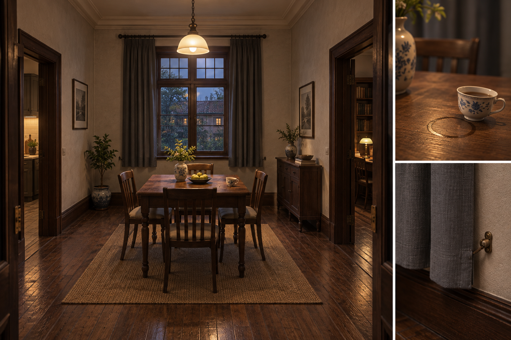
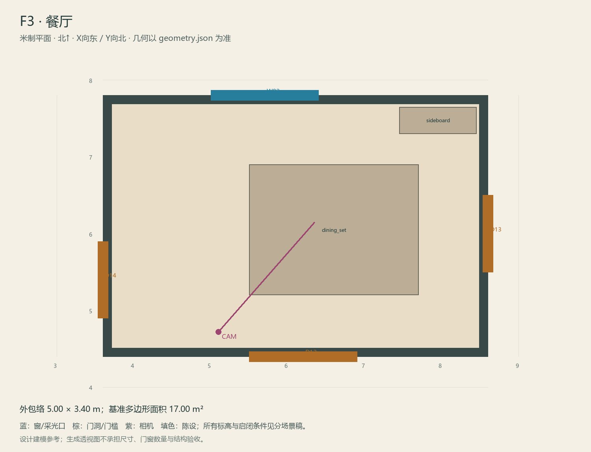

# F3 · 餐厅

ASSET-071 · 一层 · 第一夜建模参考，尚非已建成模型。

## 场景叙事与镜头

四人餐桌、小餐边柜、深木窗与双层帘，木地板上保留杯垫轻微错位。餐桌不填满房间，围桌可顺畅绕行。

事件：A03/A14/A43/A44。必须可读：杯子与杯垫；窗帘下摆左/右漏缝和右侧搭扣；餐厅窗线必须接到室外而非内墙。

推荐构图：从客厅入口看餐桌与窗帘；补帘缝/搭扣近景。 透视图表达材质和氛围，下面的坐标与正交图控制建模。

## 精确结构

世界坐标 X 东/Y 北/Z 上，单位米。地坪 Z=0.0；净高参考 3.2；基准包络 5.00×3.40；多边形面积 17.00㎡。面积为基准线围合面积，净面积须按 geometry.json 的墙厚约定扣除。

基准顶点：`[[3.6, 4.4], [8.6, 4.4], [8.6, 7.8], [3.6, 7.8]]`。房间源对象原点：`[3.6, 7.8, 0.0]`；禁止整体重置 Location。

门洞：

| 编号 | 相邻节点 | 门槛中心 XYZ | 净宽×高 | 沿轴 | 门禁 |
| --- | --- | --- | --- | --- | --- |
| D12 | F2 | [6.2, 4.4, 0] | 1.4×2.4 | X | always_open |
| D13 | F4 | [8.6, 6.0, 0] | 1.0×2.2 | Y | always_open |
| D14 | F5 | [3.6, 5.4, 0] | 1.0×2.1 | Y | always_open |

窗/开口：

| 编号 | 中心 XYZ | 宽×高 | 窗台 | 沿轴 | 视线目标 |
| --- | --- | --- | --- | --- | --- |
| W02 | [5.7, 7.8, 1.475] | 1.4×1.45 | 0.75 | X | O2 |

## 陈设与观察位

| 资产套件 | 尺寸 W/D/H | 底面中心 XYZ | Z旋转° | 碰撞 | 说明 |
| --- | --- | --- | --- | --- | --- |
| dining_set | [2.2, 1.7, 0.78] | [6.6, 6.05, 0] | 0 | True | 尺寸含四把收拢椅子的正常占地；杯垫在桌面而非另占地。 |
| sideboard | [1.0, 0.35, 0.9] | [7.95, 7.47, 0] | 0 | True | 北墙餐边柜，避开东侧书房门。 |

相机：`{"position": [5.1, 4.72, 1.58], "target": [6.35, 6.15, 1.18], "lens_mm": 28}`。

通行检查：北侧桌沿6.90到墙净面7.65为0.75m；窗帘操作位放在窗西侧x=4.5..5.3，可从西侧1.7m通路到达。东侧通道净宽0.80m。

## 状态与制作分件

M：日常洁净餐具；W：四人桌只留一份用过餐具、完整遮光布和旧灯影；同镜头对照。

室内：灰米矿物抹灰、深棕木窗及踢脚、保养木地板；现代修补克制保留。 精确色值、材质粗糙度、贴图复用规则见 [visual-bible.md](../visual-bible.md)。

静态墙地顶、门窗框和普通陈设分集合制作；可动门扇、窗帘、锁、开关、抽屉、纸张、电话及手镜必须独立。关键道具尺寸、状态和操作见 [interaction-specs.md](../interaction-specs.md)。

Blender 保留高精度可编辑源，倒角按真实尺度制作，禁止把贴图阴影烘成唯一细节。优化导出单独生成；面数/贴图预算由实机性能复核，不能以占位模型冒充最终资产。完整交接见 [blender-handoff.md](../blender-handoff.md)。

## 此场景验收

- 逐一核对本页门窗与 geometry.json；检查墙厚、门扇扫掠区与上方梁底净空。
- 从相机位确认“必须可读”的道具与退路都可辨，普通装饰不得遮挡。
- 核对 M/W/G 只变化本页批准的局部；不引入额外通道。
- 建模完成后另验 UV、法线、贴图嵌入、碰撞与 目标引擎 运行；当前包不提供这些尚未发生的通过证据。

[返回总览](../index.html)
