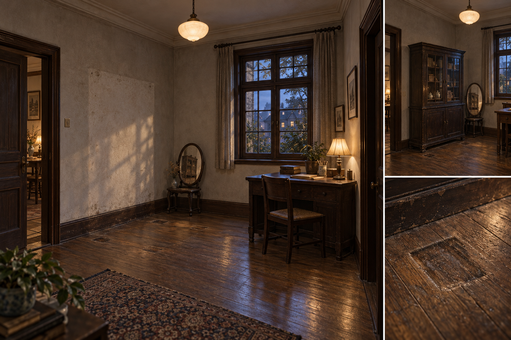
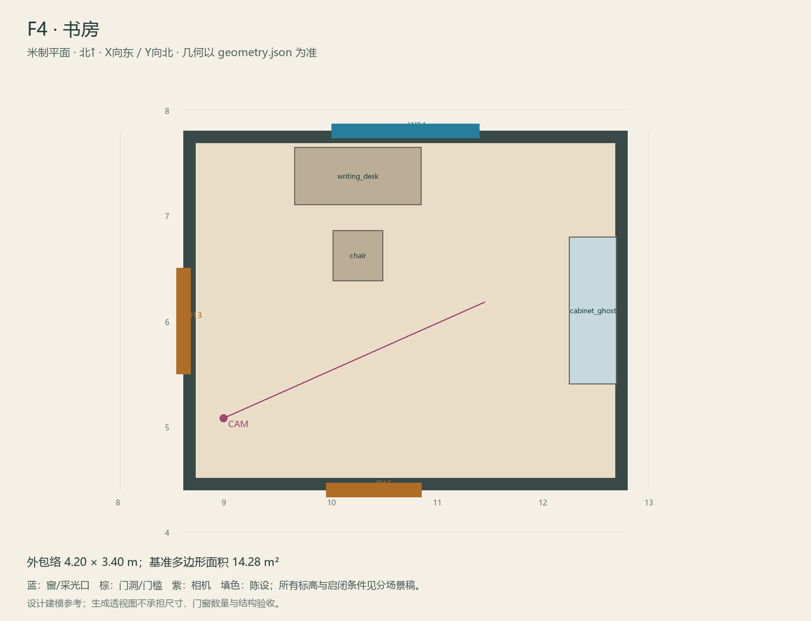

# F4 · 书房

ASSET-072 · 一层 · 第一夜建模参考，尚非已建成模型。

## 场景叙事与镜头

现代写字桌放在侧面，原旧柜位置刻意留空；墙面有一块浅矩形，地板有两处清楚的柜脚压痕。几本翻修与经营用册页。

事件：A15/A36/H4/V1。必须可读：V1固定观察位；两种实体印痕不能被新家具/地毯盖住；D6整理页可近看。

推荐构图：从门口看空柜位和写字桌；补两处痕迹与镜中旧柜配对。 透视图表达材质和氛围，下面的坐标与正交图控制建模。

## 精确结构

世界坐标 X 东/Y 北/Z 上，单位米。地坪 Z=0.0；净高参考 3.2；基准包络 4.20×3.40；多边形面积 14.28㎡。面积为基准线围合面积，净面积须按 geometry.json 的墙厚约定扣除。

基准顶点：`[[8.6, 4.4], [12.8, 4.4], [12.8, 7.8], [8.6, 7.8]]`。房间源对象原点：`[8.6, 7.8, 0.0]`；禁止整体重置 Location。

门洞：

| 编号 | 相邻节点 | 门槛中心 XYZ | 净宽×高 | 沿轴 | 门禁 |
| --- | --- | --- | --- | --- | --- |
| D13 | F3 | [8.6, 6.0, 0] | 1.0×2.2 | Y | always_open |
| D15 | F8 | [10.4, 4.4, 0] | 0.9×2.1 | X | always_open |

窗/开口：

| 编号 | 中心 XYZ | 宽×高 | 窗台 | 沿轴 | 视线目标 |
| --- | --- | --- | --- | --- | --- |
| W04 | [10.7, 7.8, 1.475] | 1.4×1.45 | 0.75 | X | O2 |

## 陈设与观察位

| 资产套件 | 尺寸 W/D/H | 底面中心 XYZ | Z旋转° | 碰撞 | 说明 |
| --- | --- | --- | --- | --- | --- |
| writing_desk | [1.2, 0.55, 0.76] | [10.25, 7.38, 0] | 0 | True | 北墙书桌，D6在桌面；按0.15m墙厚退距放置。 |
| chair | [0.48, 0.48, 0.85] | [10.25, 6.62, 0] | 0 | True | 朝北，不压V1站位。 |
| cabinet_ghost | [1.4, 0.45, 1.85] | [12.475, 6.1, 0] | 90 | False | 东墙旧柜脚印，无实体碰撞；镜中旧柜对齐该位置。 |

相机：`{"position": [8.98, 5.08, 1.6], "target": [11.45, 6.18, 1.1], "lens_mm": 31}`。

通行检查：V1的实体压痕区完全留空；F3/F8两门之间保持1.0m通路。

## 状态与制作分件

M：现代书桌与旧柜缺席；W仅镜中旧景显示原柜；不把整间变成古董库。

室内：灰米矿物抹灰、深棕木窗及踢脚、保养木地板；现代修补克制保留。 精确色值、材质粗糙度、贴图复用规则见 [visual-bible.md](../visual-bible.md)。

静态墙地顶、门窗框和普通陈设分集合制作；可动门扇、窗帘、锁、开关、抽屉、纸张、电话及手镜必须独立。关键道具尺寸、状态和操作见 [interaction-specs.md](../interaction-specs.md)。

Blender 保留高精度可编辑源，倒角按真实尺度制作，禁止把贴图阴影烘成唯一细节。优化导出单独生成；面数/贴图预算由实机性能复核，不能以占位模型冒充最终资产。完整交接见 [blender-handoff.md](../blender-handoff.md)。

## 此场景验收

- 逐一核对本页门窗与 geometry.json；检查墙厚、门扇扫掠区与上方梁底净空。
- 从相机位确认“必须可读”的道具与退路都可辨，普通装饰不得遮挡。
- 核对 M/W/G 只变化本页批准的局部；不引入额外通道。
- 建模完成后另验 UV、法线、贴图嵌入、碰撞与 目标引擎 运行；当前包不提供这些尚未发生的通过证据。

[返回总览](../index.html)
