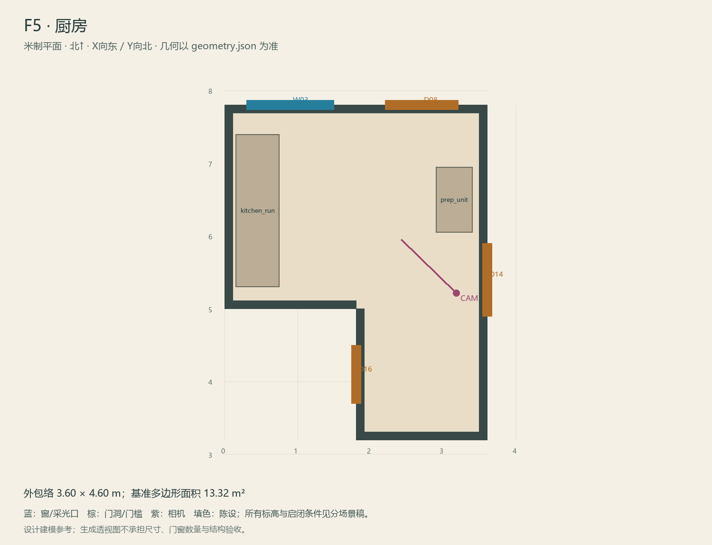

# F5 · 厨房

ASSET-073 · 一层 · 第一夜建模参考，尚非已建成模型。

此节点暂无独立透视参考；以米制图和文字规格为准。

## 场景叙事与镜头

窄型家用操作台，白灰小瓷砖，深灰下柜和保留深木窗；现代热水控制器只在M出现。通后院的门像日常后门。

事件：A09/A14/A18/H1。必须可读：窗帘内衬D1与旧钉孔；窗外钉位能从O2复查；厨房后门与旁边通F6的动线清楚。

推荐构图：从餐厅门看操作台、窗与后门；补内衬钉孔近景。 透视图表达材质和氛围，下面的坐标与正交图控制建模。

## 精确结构

世界坐标 X 东/Y 北/Z 上，单位米。地坪 Z=0.0；净高参考 3.2；基准包络 3.60×4.60；多边形面积 13.32㎡。面积为基准线围合面积，净面积须按 geometry.json 的墙厚约定扣除。

基准顶点：`[[0, 5.0], [1.8, 5.0], [1.8, 3.2], [3.6, 3.2], [3.6, 7.8], [0, 7.8]]`。房间源对象原点：`[0, 7.8, 0.0]`；禁止整体重置 Location。

门洞：

| 编号 | 相邻节点 | 门槛中心 XYZ | 净宽×高 | 沿轴 | 门禁 |
| --- | --- | --- | --- | --- | --- |
| D08 | O2 | [2.7, 7.8, 0] | 1.0×2.1 | X | inside_bolt |
| D14 | F3 | [3.6, 5.4, 0] | 1.0×2.1 | Y | always_open |
| D16 | F6 | [1.8, 4.1, 0] | 0.8×2.0 | Y | always_open |

窗/开口：

| 编号 | 中心 XYZ | 宽×高 | 窗台 | 沿轴 | 视线目标 |
| --- | --- | --- | --- | --- | --- |
| W03 | [0.9, 7.8, 1.725] | 1.2×1.25 | 1.1 | X | O2 |

## 陈设与观察位

| 资产套件 | 尺寸 W/D/H | 底面中心 XYZ | Z旋转° | 碰撞 | 说明 |
| --- | --- | --- | --- | --- | --- |
| kitchen_run | [2.1, 0.6, 0.9] | [0.45, 6.35, 0] | 90 | True | 西北操作台，不再挡住D14厨房入口。 |
| prep_unit | [0.9, 0.5, 0.9] | [3.15, 6.5, 0] | 90 | True | 东北短台；后门前0.8m站位与D14前沿保持空。 |

相机：`{"position": [3.18, 5.22, 1.6], "target": [2.42, 5.95, 1.16], "lens_mm": 28}`。

通行检查：新版F5折角令F6门位在东侧；F3入口、F6门、后门形成连续L形路线，窗下无高柜。

## 状态与制作分件

M为本夜主要可走状态；旧遮光只在窗框痕迹，第一夜不制作整套W厨房。

湿区：灰绿釉面砖/矿物防滑地砖、白陶瓷、拉丝或镀铬五金。 精确色值、材质粗糙度、贴图复用规则见 [visual-bible.md](../visual-bible.md)。

静态墙地顶、门窗框和普通陈设分集合制作；可动门扇、窗帘、锁、开关、抽屉、纸张、电话及手镜必须独立。关键道具尺寸、状态和操作见 [interaction-specs.md](../interaction-specs.md)。

Blender 保留高精度可编辑源，倒角按真实尺度制作，禁止把贴图阴影烘成唯一细节。优化导出单独生成；面数/贴图预算由实机性能复核，不能以占位模型冒充最终资产。完整交接见 [blender-handoff.md](../blender-handoff.md)。

## 此场景验收

- 逐一核对本页门窗与 geometry.json；检查墙厚、门扇扫掠区与上方梁底净空。
- 从相机位确认“必须可读”的道具与退路都可辨，普通装饰不得遮挡。
- 核对 M/W/G 只变化本页批准的局部；不引入额外通道。
- 建模完成后另验 UV、法线、贴图嵌入、碰撞与 目标引擎 运行；当前包不提供这些尚未发生的通过证据。

[返回总览](../index.html)
