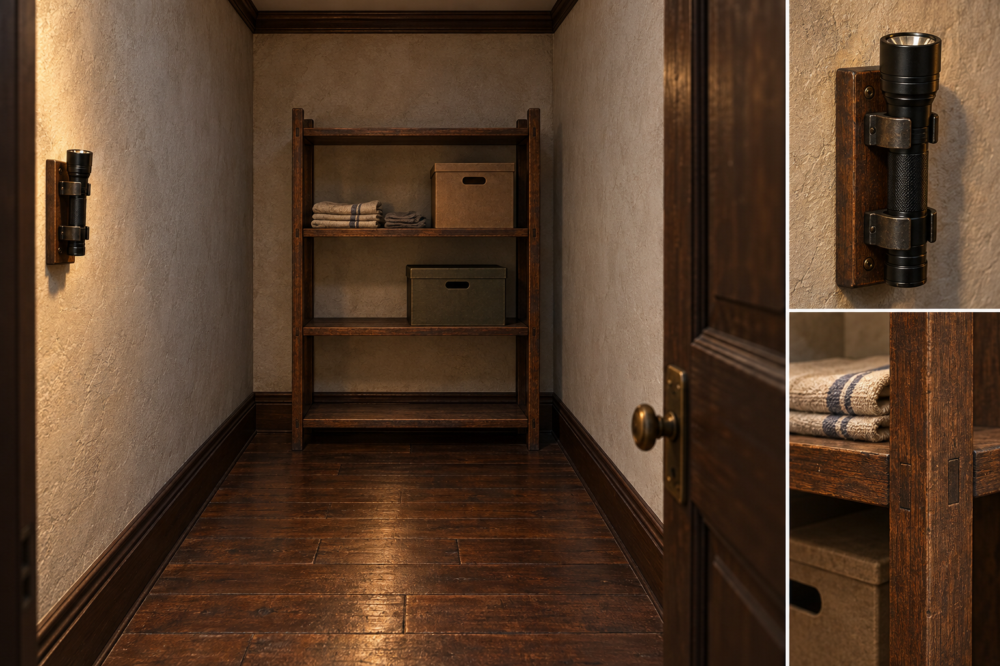
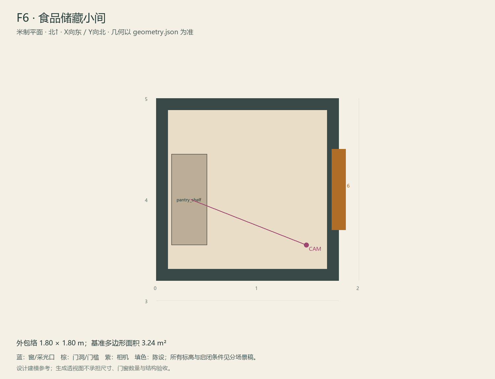

# F6 · 食品储藏小间

ASSET-074 · 一层 · 第一夜建模参考，尚非已建成模型。

## 场景叙事与镜头

小储藏位，木架上少量无品牌干粮罐和清洁用品，门边单独应急架放手电。人物仍能转身，不做满屋纸箱。

事件：A14取I1。必须可读：I1在门边1.1–1.3m高度；其余物品背景化，不误导成可合成资源。

推荐构图：门外正向略偏角看一面架子和取手电位置。 透视图表达材质和氛围，下面的坐标与正交图控制建模。

## 精确结构

世界坐标 X 东/Y 北/Z 上，单位米。地坪 Z=0.0；净高参考 3.0；基准包络 1.80×1.80；多边形面积 3.24㎡。面积为基准线围合面积，净面积须按 geometry.json 的墙厚约定扣除。

基准顶点：`[[0, 3.2], [1.8, 3.2], [1.8, 5.0], [0, 5.0]]`。房间源对象原点：`[0, 5.0, 0.0]`；禁止整体重置 Location。

门洞：

| 编号 | 相邻节点 | 门槛中心 XYZ | 净宽×高 | 沿轴 | 门禁 |
| --- | --- | --- | --- | --- | --- |
| D16 | F5 | [1.8, 4.1, 0] | 0.8×2.0 | Y | always_open |

窗/开口：

无独立外窗；不允许从透视图复制新增窗洞。

## 陈设与观察位

| 资产套件 | 尺寸 W/D/H | 底面中心 XYZ | Z旋转° | 碰撞 | 说明 |
| --- | --- | --- | --- | --- | --- |
| pantry_shelf | [0.9, 0.35, 1.75] | [0.33, 4.0, 0] | 90 | True | 西墙架，随F6迁至西南；I1固定在门边可及层1.20m高。 |

相机：`{"position": [1.48, 3.55, 1.52], "target": [0.34, 4.0, 1.22], "lens_mm": 35}`。

通行检查：新版F6架前净宽1.30m；东墙D16门洞完全无货架。

## 状态与制作分件

仅M；不额外设计W/G图。

室内：灰米矿物抹灰、深棕木窗及踢脚、保养木地板；现代修补克制保留。 精确色值、材质粗糙度、贴图复用规则见 [visual-bible.md](../visual-bible.md)。

静态墙地顶、门窗框和普通陈设分集合制作；可动门扇、窗帘、锁、开关、抽屉、纸张、电话及手镜必须独立。关键道具尺寸、状态和操作见 [interaction-specs.md](../interaction-specs.md)。

Blender 保留高精度可编辑源，倒角按真实尺度制作，禁止把贴图阴影烘成唯一细节。优化导出单独生成；面数/贴图预算由实机性能复核，不能以占位模型冒充最终资产。完整交接见 [blender-handoff.md](../blender-handoff.md)。

## 此场景验收

- 逐一核对本页门窗与 geometry.json；检查墙厚、门扇扫掠区与上方梁底净空。
- 从相机位确认“必须可读”的道具与退路都可辨，普通装饰不得遮挡。
- 核对 M/W/G 只变化本页批准的局部；不引入额外通道。
- 建模完成后另验 UV、法线、贴图嵌入、碰撞与 目标引擎 运行；当前包不提供这些尚未发生的通过证据。

[返回总览](../index.html)
