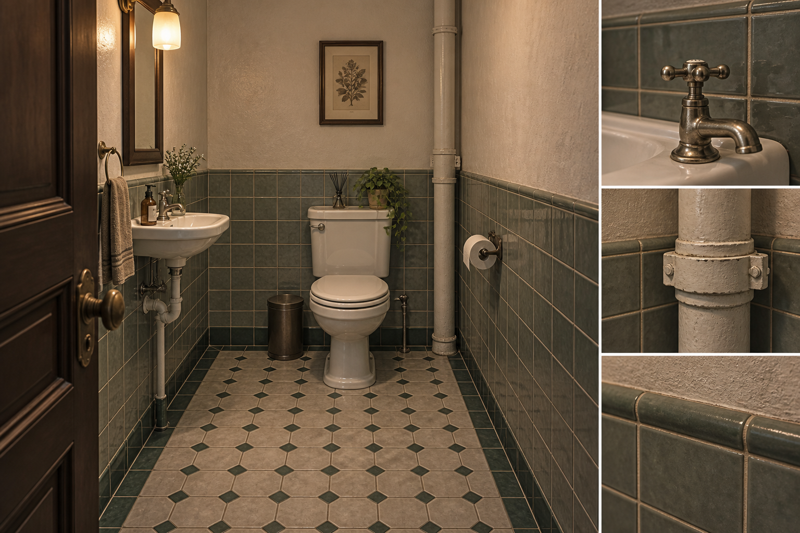
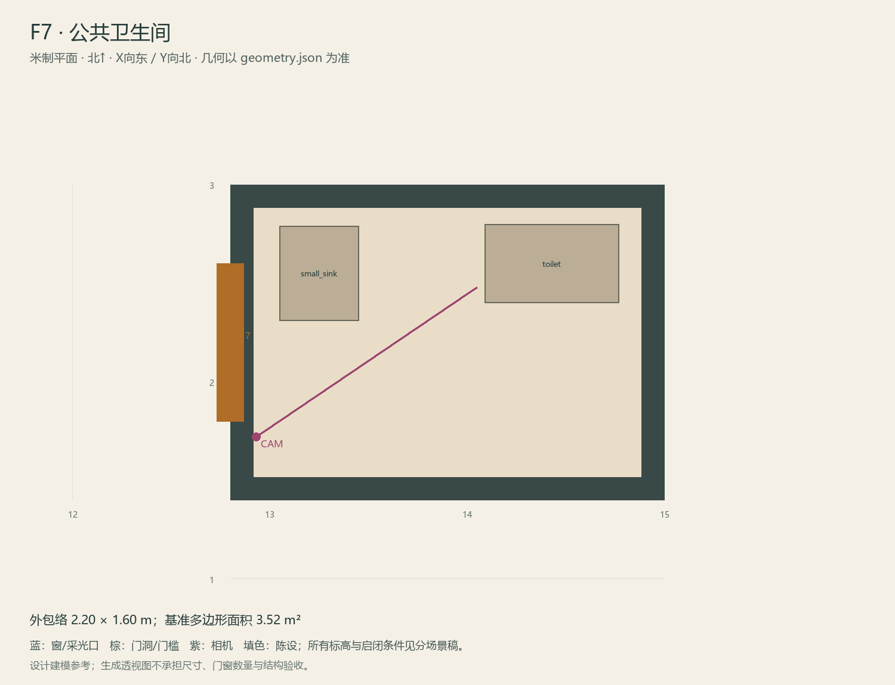

# F7 · 公共卫生间

ASSET-075 · 一层 · 第一夜建模参考，尚非已建成模型。

## 场景叙事与镜头

整洁小卫生间，半高灰白方砖、简洁坐便器和小洗手盆；上方有维修过的漆边，不渲染污物。

事件：A03可选基线。必须可读：门扇打开不碰洁具；洗手盆和厕所的尺寸像真实日常设施；不放镜子谜题。

推荐构图：从门洞看洁具布置，正常曝光。 透视图表达材质和氛围，下面的坐标与正交图控制建模。

## 精确结构

世界坐标 X 东/Y 北/Z 上，单位米。地坪 Z=0.0；净高参考 3.0；基准包络 2.20×1.60；多边形面积 3.52㎡。面积为基准线围合面积，净面积须按 geometry.json 的墙厚约定扣除。

基准顶点：`[[12.8, 1.4], [15.0, 1.4], [15.0, 3.0], [12.8, 3.0]]`。房间源对象原点：`[12.8, 3.0, 0.0]`；禁止整体重置 Location。

门洞：

| 编号 | 相邻节点 | 门槛中心 XYZ | 净宽×高 | 沿轴 | 门禁 |
| --- | --- | --- | --- | --- | --- |
| D17 | F8 | [12.8, 2.2, 0] | 0.8×2.0 | Y | always_open |

窗/开口：

无独立外窗；不允许从透视图复制新增窗洞。

## 陈设与观察位

| 资产套件 | 尺寸 W/D/H | 底面中心 XYZ | Z旋转° | 碰撞 | 说明 |
| --- | --- | --- | --- | --- | --- |
| toilet | [0.4, 0.68, 0.78] | [14.43, 2.6, 0] | 90 | True | 东墙坐便器，门扇开合不碰撞。 |
| small_sink | [0.48, 0.4, 0.85] | [13.25, 2.55, 0] | 90 | True | 西侧小洗手盆，镜面只作普通卫生设施。 |

相机：`{"position": [12.93, 1.72, 1.56], "target": [14.05, 2.48, 1.05], "lens_mm": 32}`。

通行检查：门后与洁具间最窄净宽0.85m。

## 状态与制作分件

仅M，保留之后声音作为管路来源的外观，不增加互动。

湿区：灰绿釉面砖/矿物防滑地砖、白陶瓷、拉丝或镀铬五金。 精确色值、材质粗糙度、贴图复用规则见 [visual-bible.md](../visual-bible.md)。

静态墙地顶、门窗框和普通陈设分集合制作；可动门扇、窗帘、锁、开关、抽屉、纸张、电话及手镜必须独立。关键道具尺寸、状态和操作见 [interaction-specs.md](../interaction-specs.md)。

Blender 保留高精度可编辑源，倒角按真实尺度制作，禁止把贴图阴影烘成唯一细节。优化导出单独生成；面数/贴图预算由实机性能复核，不能以占位模型冒充最终资产。完整交接见 [blender-handoff.md](../blender-handoff.md)。

## 此场景验收

- 逐一核对本页门窗与 geometry.json；检查墙厚、门扇扫掠区与上方梁底净空。
- 从相机位确认“必须可读”的道具与退路都可辨，普通装饰不得遮挡。
- 核对 M/W/G 只变化本页批准的局部；不引入额外通道。
- 建模完成后另验 UV、法线、贴图嵌入、碰撞与 目标引擎 运行；当前包不提供这些尚未发生的通过证据。

[返回总览](../index.html)
