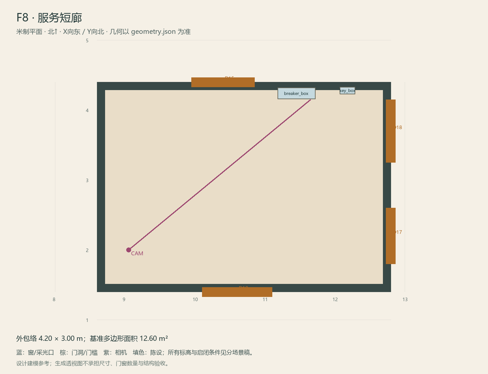

# F8 · 服务短廊

ASSET-076 · 一层 · 第一夜建模参考，尚非已建成模型。

此节点暂无独立透视参考；以米制图和文字规格为准。

## 场景叙事与镜头

窄而可通行的服务过渡带，较朴素的墙漆、明装短线管，电箱与透明应急盒在同一墙面，周围保留站人检修空地。

事件：A15/A16。必须可读：I2盒与单一电箱盖/开关；F1/F4/F7/F9连接均要留门前净空；不得用大柜占通路。

推荐构图：沿短廊看电箱，补钥匙盒和箱盖近景。 透视图表达材质和氛围，下面的坐标与正交图控制建模。

## 精确结构

世界坐标 X 东/Y 北/Z 上，单位米。地坪 Z=0.0；净高参考 3.0；基准包络 4.20×3.00；多边形面积 12.60㎡。面积为基准线围合面积，净面积须按 geometry.json 的墙厚约定扣除。

基准顶点：`[[8.6, 1.4], [12.8, 1.4], [12.8, 4.4], [8.6, 4.4]]`。房间源对象原点：`[8.6, 4.4, 0.0]`；禁止整体重置 Location。

门洞：

| 编号 | 相邻节点 | 门槛中心 XYZ | 净宽×高 | 沿轴 | 门禁 |
| --- | --- | --- | --- | --- | --- |
| D10 | F1 | [10.6, 1.4, 0] | 1.0×2.1 | X | always_open |
| D15 | F4 | [10.4, 4.4, 0] | 0.9×2.1 | X | always_open |
| D17 | F7 | [12.8, 2.2, 0] | 0.8×2.0 | Y | always_open |
| D18 | F9 | [12.8, 3.7, 0] | 0.9×2.0 | Y | I2 |

窗/开口：

无独立外窗；不允许从透视图复制新增窗洞。

## 陈设与观察位

| 资产套件 | 尺寸 W/D/H | 底面中心 XYZ | Z旋转° | 碰撞 | 说明 |
| --- | --- | --- | --- | --- | --- |
| breaker_box | [0.55, 0.16, 0.7] | [11.45, 4.24, 1.05] | 0 | False | 北墙挂装，移离D15书房门洞；箱盖与开关为动态独立件。 |
| key_box | [0.22, 0.1, 0.28] | [12.18, 4.28, 1.18] | 0 | False | 北墙挂装，I2可站在廊中心取得。 |

相机：`{"position": [9.05, 2.0, 1.58], "target": [11.65, 4.15, 1.2], "lens_mm": 30}`。

通行检查：D15书房门洞x=9.95–10.85已完全避开；四扇连接门前均无落地柜，电箱操作面净宽1.05m。

## 状态与制作分件

仅M；N7边界用门槛状态处理，不重做全廊。

室内：灰米矿物抹灰、深棕木窗及踢脚、保养木地板；现代修补克制保留。 精确色值、材质粗糙度、贴图复用规则见 [visual-bible.md](../visual-bible.md)。

静态墙地顶、门窗框和普通陈设分集合制作；可动门扇、窗帘、锁、开关、抽屉、纸张、电话及手镜必须独立。关键道具尺寸、状态和操作见 [interaction-specs.md](../interaction-specs.md)。

Blender 保留高精度可编辑源，倒角按真实尺度制作，禁止把贴图阴影烘成唯一细节。优化导出单独生成；面数/贴图预算由实机性能复核，不能以占位模型冒充最终资产。完整交接见 [blender-handoff.md](../blender-handoff.md)。

## 此场景验收

- 逐一核对本页门窗与 geometry.json；检查墙厚、门扇扫掠区与上方梁底净空。
- 从相机位确认“必须可读”的道具与退路都可辨，普通装饰不得遮挡。
- 核对 M/W/G 只变化本页批准的局部；不引入额外通道。
- 建模完成后另验 UV、法线、贴图嵌入、碰撞与 目标引擎 运行；当前包不提供这些尚未发生的通过证据。

[返回总览](../index.html)
