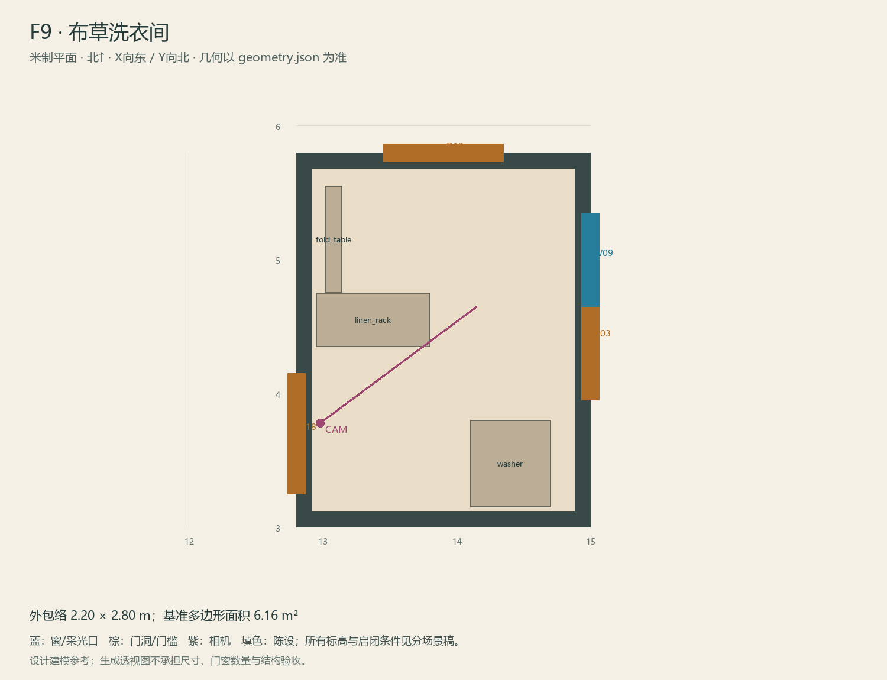

# F9 · 布草洗衣间

ASSET-077 · 一层 · 第一夜建模参考，尚非已建成模型。

此节点暂无独立透视参考；以米制图和文字规格为准。

## 场景叙事与镜头

一组洗衣机和叠放干净布草的窄架，折叠台靠墙。服务门与院门之间不摆物，地面耐用浅灰砖。

事件：A17/A35及外圈回程。必须可读：通O5内侧插销，通F10门，玩家背着视角经过也能认出机身与白布草两个体块。

推荐构图：从服务廊门看布草与院门，结构优先。 透视图表达材质和氛围，下面的坐标与正交图控制建模。

## 精确结构

世界坐标 X 东/Y 北/Z 上，单位米。地坪 Z=0.0；净高参考 3.0；基准包络 2.20×2.80；多边形面积 6.16㎡。面积为基准线围合面积，净面积须按 geometry.json 的墙厚约定扣除。

基准顶点：`[[12.8, 3.0], [15.0, 3.0], [15.0, 5.8], [12.8, 5.8]]`。房间源对象原点：`[12.8, 5.8, 0.0]`；禁止整体重置 Location。

门洞：

| 编号 | 相邻节点 | 门槛中心 XYZ | 净宽×高 | 沿轴 | 门禁 |
| --- | --- | --- | --- | --- | --- |
| D03 | O5 | [15, 4.4, 0] | 0.9×2.0 | Y | I2 |
| D18 | F8 | [12.8, 3.7, 0] | 0.9×2.0 | Y | I2 |
| D19 | F10 | [13.9, 5.8, 0] | 0.9×2.0 | X | I2 |

窗/开口：

| 编号 | 中心 XYZ | 宽×高 | 窗台 | 沿轴 | 视线目标 |
| --- | --- | --- | --- | --- | --- |
| W09 | [15.0, 5.0, 1.85] | 0.7×0.8 | 1.45 | Y | O5 |

## 陈设与观察位

| 资产套件 | 尺寸 W/D/H | 底面中心 XYZ | Z旋转° | 碰撞 | 说明 |
| --- | --- | --- | --- | --- | --- |
| washer | [0.6, 0.65, 0.85] | [14.4, 3.48, 0] | 0 | True | 南墙右侧；不压F8来门，离墙0.15m。 |
| linen_rack | [0.85, 0.4, 1.7] | [13.38, 4.55, 0] | 0 | True | 西侧中段布草架；避开F8门前和F10北门的0.8m操作区。 |
| fold_table | [0.8, 0.12, 0.9] | [13.08, 5.15, 0.45] | 90 | True | 收起状态真实薄包络；展开宽0.8深0.45，本章不要求展开。 |

相机：`{"position": [12.98, 3.78, 1.55], "target": [14.15, 4.65, 1.05], "lens_mm": 32}`。

通行检查：F8-F10-O5的中心折线路线净宽0.83–0.95m；F10北门前0.8m深区域无物件，三件后勤物全部靠边。

## 状态与制作分件

M；不制作复杂洗衣机动画或W机器变体。

湿区：灰绿釉面砖/矿物防滑地砖、白陶瓷、拉丝或镀铬五金。 精确色值、材质粗糙度、贴图复用规则见 [visual-bible.md](../visual-bible.md)。

静态墙地顶、门窗框和普通陈设分集合制作；可动门扇、窗帘、锁、开关、抽屉、纸张、电话及手镜必须独立。关键道具尺寸、状态和操作见 [interaction-specs.md](../interaction-specs.md)。

Blender 保留高精度可编辑源，倒角按真实尺度制作，禁止把贴图阴影烘成唯一细节。优化导出单独生成；面数/贴图预算由实机性能复核，不能以占位模型冒充最终资产。完整交接见 [blender-handoff.md](../blender-handoff.md)。

## 此场景验收

- 逐一核对本页门窗与 geometry.json；检查墙厚、门扇扫掠区与上方梁底净空。
- 从相机位确认“必须可读”的道具与退路都可辨，普通装饰不得遮挡。
- 核对 M/W/G 只变化本页批准的局部；不引入额外通道。
- 建模完成后另验 UV、法线、贴图嵌入、碰撞与 目标引擎 运行；当前包不提供这些尚未发生的通过证据。

[返回总览](../index.html)
