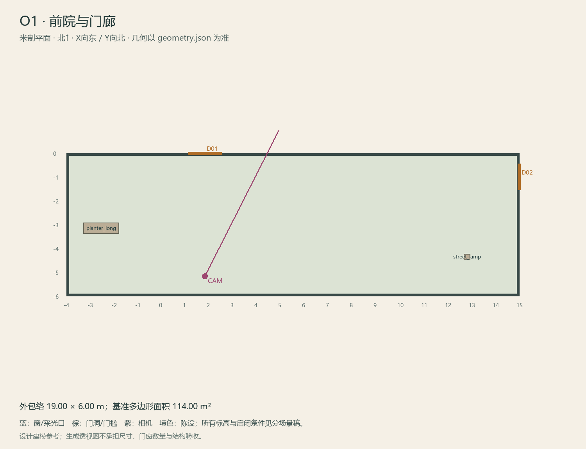

# O1 · 前院与门廊

ASSET-088 · 室外 · 第一夜建模参考，尚非已建成模型。

此节点暂无独立透视参考；以米制图和文字规格为准。

## 场景叙事与镜头

浅石板与少量花坛的窄前院，低围墙铁门和一盏普通街灯。房子偏置，入口不居中，大部分地面可行走。

事件：A01/A40/A49/A50。必须可读：院门外排水沟与街灯底座的连接；后勤小院捷径；门廊到F1主门平顺。

推荐构图：从院门看偏置门廊与主楼正面；近景沟沿/灯座。 透视图表达材质和氛围，下面的坐标与正交图控制建模。

## 精确结构

世界坐标 X 东/Y 北/Z 上，单位米。地坪 Z=0.0；净高参考 0.0；基准包络 19.00×6.00；多边形面积 114.00㎡。面积为基准线围合面积，净面积须按 geometry.json 的墙厚约定扣除。

基准顶点：`[[-4, -6], [15, -6], [15, 0], [-4, 0]]`。房间源对象原点：`[-4, 0, 0.0]`；禁止整体重置 Location。

门洞：

| 编号 | 相邻节点 | 门槛中心 XYZ | 净宽×高 | 沿轴 | 门禁 |
| --- | --- | --- | --- | --- | --- |
| D01 | F1 | [1.8, 0, 0] | 1.4×2.4 | X | order_unlocked |
| D02 | O5 | [15, -1, 0] | 1.1×2.0 | Y | O5_side_bolt |

窗/开口：

无独立外窗；不允许从透视图复制新增窗洞。

## 陈设与观察位

| 资产套件 | 尺寸 W/D/H | 底面中心 XYZ | Z旋转° | 碰撞 | 说明 |
| --- | --- | --- | --- | --- | --- |
| planter_long | [1.5, 0.45, 0.45] | [-2.55, -3.15, 0] | 0 | True | 西侧围墙花槽。 |
| street_lamp | [0.25, 0.25, 3.2] | [12.8, -4.35, 0] | 0 | True | 东侧院角路灯，正门与院门视线不被遮挡。 |

相机：`{"position": [1.8, -5.18, 1.66], "target": [4.9, 0.95, 2.25], "lens_mm": 26}`。

通行检查：P01从院门至正门保持1.2m以上石板通行带。

## 状态与制作分件

黄昏/夜间/真实清晨只换光与外部断接小块；不用大型街景。

室外：灰石铺地、红褐砖基、灰泥围墙，排水沟与地标独立分件。 精确色值、材质粗糙度、贴图复用规则见 [visual-bible.md](../visual-bible.md)。

静态墙地顶、门窗框和普通陈设分集合制作；可动门扇、窗帘、锁、开关、抽屉、纸张、电话及手镜必须独立。关键道具尺寸、状态和操作见 [interaction-specs.md](../interaction-specs.md)。

Blender 保留高精度可编辑源，倒角按真实尺度制作，禁止把贴图阴影烘成唯一细节。优化导出单独生成；面数/贴图预算由实机性能复核，不能以占位模型冒充最终资产。完整交接见 [blender-handoff.md](../blender-handoff.md)。

## 此场景验收

- 逐一核对本页门窗与 geometry.json；检查墙厚、门扇扫掠区与上方梁底净空。
- 从相机位确认“必须可读”的道具与退路都可辨，普通装饰不得遮挡。
- 核对 M/W/G 只变化本页批准的局部；不引入额外通道。
- 建模完成后另验 UV、法线、贴图嵌入、碰撞与 目标引擎 运行；当前包不提供这些尚未发生的通过证据。

[返回总览](../index.html)
