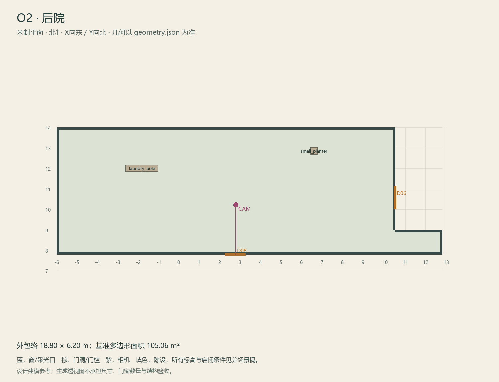

# O2 · 后院

ASSET-089 · 室外 · 第一夜建模参考，尚非已建成模型。

此节点暂无独立透视参考；以米制图和文字规格为准。

## 场景叙事与镜头

生活化的后院，晾衣杆、少量盆栽、厨房窗与旧后门，墙脚局部湿痕，地面清扫过。留出绕院通道。

事件：A18/A36/H1。必须可读：可从U3/U6/U8辨認晾衣杆；厨房窗外旧钉孔与内侧对应；通O3侧巷。

推荐构图：从厨房后门看晾衣杆与侧巷入口，背景可见二楼木窗。 透视图表达材质和氛围，下面的坐标与正交图控制建模。

## 精确结构

世界坐标 X 东/Y 北/Z 上，单位米。地坪 Z=0.0；净高参考 0.0；基准包络 18.80×6.20；多边形面积 105.06㎡。面积为基准线围合面积，净面积须按 geometry.json 的墙厚约定扣除。

基准顶点：`[[-6, 7.8], [12.8, 7.8], [12.8, 9.0], [10.5, 9.0], [10.5, 14.0], [-6, 14.0]]`。房间源对象原点：`[-6, 14.0, 0.0]`；禁止整体重置 Location。

门洞：

| 编号 | 相邻节点 | 门槛中心 XYZ | 净宽×高 | 沿轴 | 门禁 |
| --- | --- | --- | --- | --- | --- |
| D06 | O3 | [10.5, 10.6, 0] | 1.1×2.0 | Y | I2 |
| D08 | F5 | [2.7, 7.8, 0] | 1.0×2.1 | X | inside_bolt |

窗/开口：

无独立外窗；不允许从透视图复制新增窗洞。

## 陈设与观察位

| 资产套件 | 尺寸 W/D/H | 底面中心 XYZ | Z旋转° | 碰撞 | 说明 |
| --- | --- | --- | --- | --- | --- |
| laundry_pole | [1.6, 0.35, 2.1] | [-1.85, 12.0, 0] | 0 | True | 西北晾衣杆，后院窗线仍可直视。 |
| small_planter | [0.35, 0.35, 0.4] | [6.55, 12.85, 0] | 0 | True | 东侧低花盆，不遮P03侧巷入口。 |

相机：`{"position": [2.72, 10.22, 1.62], "target": [2.72, 7.8, 1.58], "lens_mm": 27}`。

通行检查：厨房窗、后门、晾衣杆和侧巷均能通过不被占用的地面读出。

## 状态与制作分件

M为本夜基线；第二夜只预留W物件替换接口，不画战场。

室外：灰石铺地、红褐砖基、灰泥围墙，排水沟与地标独立分件。 精确色值、材质粗糙度、贴图复用规则见 [visual-bible.md](../visual-bible.md)。

静态墙地顶、门窗框和普通陈设分集合制作；可动门扇、窗帘、锁、开关、抽屉、纸张、电话及手镜必须独立。关键道具尺寸、状态和操作见 [interaction-specs.md](../interaction-specs.md)。

Blender 保留高精度可编辑源，倒角按真实尺度制作，禁止把贴图阴影烘成唯一细节。优化导出单独生成；面数/贴图预算由实机性能复核，不能以占位模型冒充最终资产。完整交接见 [blender-handoff.md](../blender-handoff.md)。

## 此场景验收

- 逐一核对本页门窗与 geometry.json；检查墙厚、门扇扫掠区与上方梁底净空。
- 从相机位确认“必须可读”的道具与退路都可辨，普通装饰不得遮挡。
- 核对 M/W/G 只变化本页批准的局部；不引入额外通道。
- 建模完成后另验 UV、法线、贴图嵌入、碰撞与 目标引擎 运行；当前包不提供这些尚未发生的通过证据。

[返回总览](../index.html)
