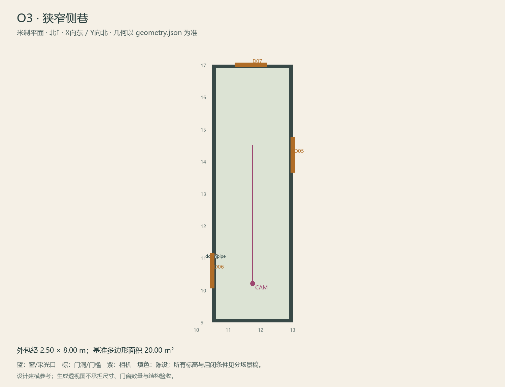

# O3 · 狭窄侧巷

ASSET-090 · 室外 · 第一夜建模参考，尚非已建成模型。

此节点暂无独立透视参考；以米制图和文字规格为准。

## 场景叙事与镜头

有天光的窄步行巷，洋楼侧墙与邻界围墙夹成，靠一侧的明沟把后院方向连向树院；管道只少量。

事件：A37。必须可读：O2/O4/O6三向关系与门号；沟沿连续；不要无尽重复拱廊。

推荐构图：从后院一端沿巷看树院方向，显示沟沿和天空。 透视图表达材质和氛围，下面的坐标与正交图控制建模。

## 精确结构

世界坐标 X 东/Y 北/Z 上，单位米。地坪 Z=0.0；净高参考 0.0；基准包络 2.50×8.00；多边形面积 20.00㎡。面积为基准线围合面积，净面积须按 geometry.json 的墙厚约定扣除。

基准顶点：`[[10.5, 9.0], [13.0, 9.0], [13.0, 17.0], [10.5, 17.0]]`。房间源对象原点：`[10.5, 17.0, 0.0]`；禁止整体重置 Location。

门洞：

| 编号 | 相邻节点 | 门槛中心 XYZ | 净宽×高 | 沿轴 | 门禁 |
| --- | --- | --- | --- | --- | --- |
| D05 | O4 | [13.0, 14.2, 0] | 1.1×2.0 | Y | open_after_N2 |
| D06 | O2 | [10.5, 10.6, 0] | 1.1×2.0 | Y | I2 |
| D07 | O6 | [11.7, 17.0, 0] | 1.0×2.0 | X | never_open |

窗/开口：

无独立外窗；不允许从透视图复制新增窗洞。

## 陈设与观察位

| 资产套件 | 尺寸 W/D/H | 底面中心 XYZ | Z旋转° | 碰撞 | 说明 |
| --- | --- | --- | --- | --- | --- |
| downpipe | [0.12, 0.12, 3.0] | [10.6, 11.05, 0] | 0 | False | 西墙挂装雨水管，和连续排水沟共同指向O4。 |

相机：`{"position": [11.75, 10.2, 1.62], "target": [11.75, 14.5, 1.2], "lens_mm": 30}`。

通行检查：中央保留1.5m以上侧巷走带，排水沟沿东侧可读。

## 状态与制作分件

M；G相关假门实际位于O4，O3自身保持稳定锚点。

室外：灰石铺地、红褐砖基、灰泥围墙，排水沟与地标独立分件。 精确色值、材质粗糙度、贴图复用规则见 [visual-bible.md](../visual-bible.md)。

静态墙地顶、门窗框和普通陈设分集合制作；可动门扇、窗帘、锁、开关、抽屉、纸张、电话及手镜必须独立。关键道具尺寸、状态和操作见 [interaction-specs.md](../interaction-specs.md)。

Blender 保留高精度可编辑源，倒角按真实尺度制作，禁止把贴图阴影烘成唯一细节。优化导出单独生成；面数/贴图预算由实机性能复核，不能以占位模型冒充最终资产。完整交接见 [blender-handoff.md](../blender-handoff.md)。

## 此场景验收

- 逐一核对本页门窗与 geometry.json；检查墙厚、门扇扫掠区与上方梁底净空。
- 从相机位确认“必须可读”的道具与退路都可辨，普通装饰不得遮挡。
- 核对 M/W/G 只变化本页批准的局部；不引入额外通道。
- 建模完成后另验 UV、法线、贴图嵌入、碰撞与 目标引擎 运行；当前包不提供这些尚未发生的通过证据。

[返回总览](../index.html)
