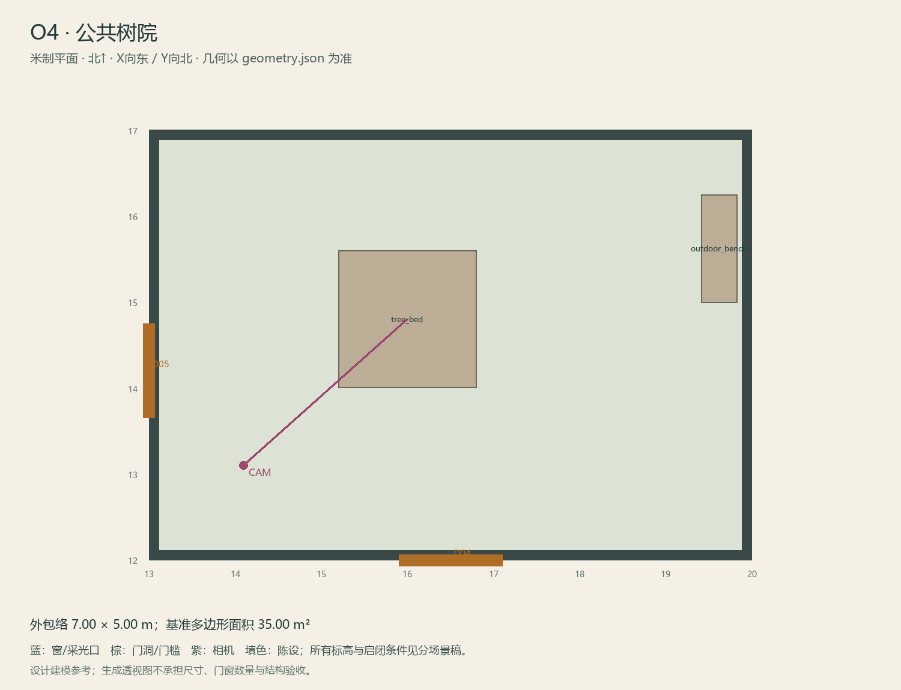

# O4 · 公共树院

ASSET-091 · 室外 · 第一夜建模参考，尚非已建成模型。

此节点暂无独立透视参考；以米制图和文字规格为准。

## 场景叙事与镜头

紧凑邻里公共院落，一棵树、低花池边与排水沟，朴素长凳靠墙。墙面有林远的简单方向记号。

事件：A38。必须可读：树根和沟沿为两项独立固定锚点；正常去O5的路清楚；G假门只在指定无通路墙面。

推荐构图：站在侧巷出口看树与沟及正常回程口；补假门局部对照。 透视图表达材质和氛围，下面的坐标与正交图控制建模。

## 精确结构

世界坐标 X 东/Y 北/Z 上，单位米。地坪 Z=0.0；净高参考 0.0；基准包络 7.00×5.00；多边形面积 35.00㎡。面积为基准线围合面积，净面积须按 geometry.json 的墙厚约定扣除。

基准顶点：`[[13.0, 12.0], [20.0, 12.0], [20.0, 17.0], [13.0, 17.0]]`。房间源对象原点：`[13.0, 17.0, 0.0]`；禁止整体重置 Location。

门洞：

| 编号 | 相邻节点 | 门槛中心 XYZ | 净宽×高 | 沿轴 | 门禁 |
| --- | --- | --- | --- | --- | --- |
| D04 | O5 | [16.5, 12, 0] | 1.2×2.0 | X | open_after_N2 |
| D05 | O3 | [13.0, 14.2, 0] | 1.1×2.0 | Y | open_after_N2 |

窗/开口：

无独立外窗；不允许从透视图复制新增窗洞。

## 陈设与观察位

| 资产套件 | 尺寸 W/D/H | 底面中心 XYZ | Z旋转° | 碰撞 | 说明 |
| --- | --- | --- | --- | --- | --- |
| tree_bed | [1.6, 1.6, 0.4] | [16, 14.8, 0] | 0 | True | 树池离西侧D05入口足够远；树根朝南侧排水沟伸展，门前不堵。 |
| outdoor_bench | [1.25, 0.42, 0.78] | [19.62, 15.62, 0] | 90 | True | 靠东墙长凳，避开南侧正常出口。 |

相机：`{"position": [14.1, 13.1, 1.64], "target": [16, 14.8, 1.18], "lens_mm": 28}`。

通行检查：O3-O5正常线沿南/东侧保留1.2m；假门仅立面，不放实体阻挡。

## 状态与制作分件

M：正常墙与箭头；G：同一墙面显出重复箭头假门，树/沟绝不整体换位。

室外：灰石铺地、红褐砖基、灰泥围墙，排水沟与地标独立分件。 精确色值、材质粗糙度、贴图复用规则见 [visual-bible.md](../visual-bible.md)。

静态墙地顶、门窗框和普通陈设分集合制作；可动门扇、窗帘、锁、开关、抽屉、纸张、电话及手镜必须独立。关键道具尺寸、状态和操作见 [interaction-specs.md](../interaction-specs.md)。

Blender 保留高精度可编辑源，倒角按真实尺度制作，禁止把贴图阴影烘成唯一细节。优化导出单独生成；面数/贴图预算由实机性能复核，不能以占位模型冒充最终资产。完整交接见 [blender-handoff.md](../blender-handoff.md)。

## 此场景验收

- 逐一核对本页门窗与 geometry.json；检查墙厚、门扇扫掠区与上方梁底净空。
- 从相机位确认“必须可读”的道具与退路都可辨，普通装饰不得遮挡。
- 核对 M/W/G 只变化本页批准的局部；不引入额外通道。
- 建模完成后另验 UV、法线、贴图嵌入、碰撞与 目标引擎 运行；当前包不提供这些尚未发生的通过证据。

[返回总览](../index.html)
