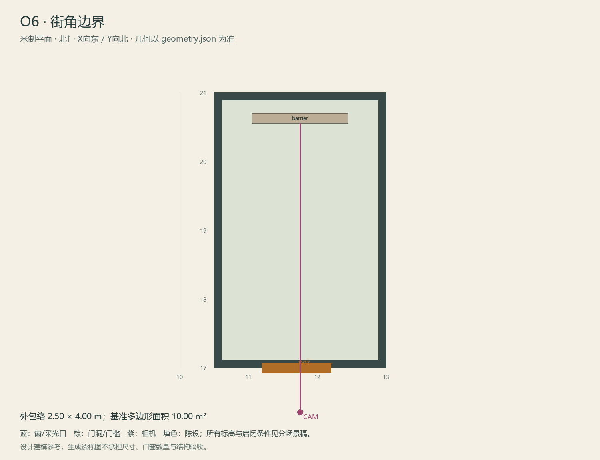

# O6 · 街角边界

ASSET-093 · 室外 · 第一夜建模参考，尚非已建成模型。

此节点暂无独立透视参考；以米制图和文字规格为准。

## 场景叙事与镜头

侧巷尽端稍放宽的一角，路牌背面、封闭围挡和一小截现代路面。远处建筑以低细节天际线结束。

事件：A37可选。必须可读：林远折返痕迹；明确画外不开放，不画诱人的可探索新街道。

推荐构图：从侧巷看街角封闭边界，正常曝光。 透视图表达材质和氛围，下面的坐标与正交图控制建模。

## 精确结构

世界坐标 X 东/Y 北/Z 上，单位米。地坪 Z=0.0；净高参考 0.0；基准包络 2.50×4.00；多边形面积 10.00㎡。面积为基准线围合面积，净面积须按 geometry.json 的墙厚约定扣除。

基准顶点：`[[10.5, 17.0], [13.0, 17.0], [13.0, 21.0], [10.5, 21.0]]`。房间源对象原点：`[10.5, 21.0, 0.0]`；禁止整体重置 Location。

门洞：

| 编号 | 相邻节点 | 门槛中心 XYZ | 净宽×高 | 沿轴 | 门禁 |
| --- | --- | --- | --- | --- | --- |
| D07 | O3 | [11.7, 17.0, 0] | 1.0×2.0 | X | never_open |

窗/开口：

无独立外窗；不允许从透视图复制新增窗洞。

## 陈设与观察位

| 资产套件 | 尺寸 W/D/H | 底面中心 XYZ | Z旋转° | 碰撞 | 说明 |
| --- | --- | --- | --- | --- | --- |
| barrier | [1.4, 0.15, 1.6] | [11.75, 20.62, 0] | 0 | True | 北端可见施工边界；之后只有背景街景。 |

相机：`{"position": [11.75, 16.35, 1.62], "target": [11.75, 20.55, 1.3], "lens_mm": 32}`。

通行检查：站位属于O3，从D07封闭透视铁门向O6看；不进入O6，不生成可行走街区。

## 状态与制作分件

仅M；留第二夜扩展接口但本次不制作后续场景。

室外：灰石铺地、红褐砖基、灰泥围墙，排水沟与地标独立分件。 精确色值、材质粗糙度、贴图复用规则见 [visual-bible.md](../visual-bible.md)。

静态墙地顶、门窗框和普通陈设分集合制作；可动门扇、窗帘、锁、开关、抽屉、纸张、电话及手镜必须独立。关键道具尺寸、状态和操作见 [interaction-specs.md](../interaction-specs.md)。

Blender 保留高精度可编辑源，倒角按真实尺度制作，禁止把贴图阴影烘成唯一细节。优化导出单独生成；面数/贴图预算由实机性能复核，不能以占位模型冒充最终资产。完整交接见 [blender-handoff.md](../blender-handoff.md)。

## 此场景验收

- 逐一核对本页门窗与 geometry.json；检查墙厚、门扇扫掠区与上方梁底净空。
- 从相机位确认“必须可读”的道具与退路都可辨，普通装饰不得遮挡。
- 核对 M/W/G 只变化本页批准的局部；不引入额外通道。
- 建模完成后另验 UV、法线、贴图嵌入、碰撞与 目标引擎 运行；当前包不提供这些尚未发生的通过证据。

[返回总览](../index.html)
