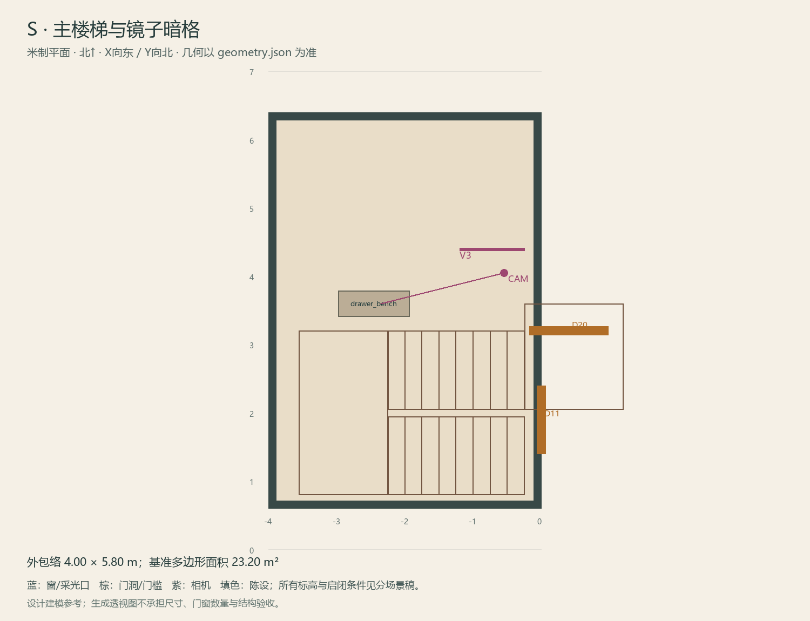

# S · 主楼梯与镜子暗格

ASSET-079 · 唯一主楼梯 · 第一夜建模参考，尚非已建成模型。

此节点暂无独立透视参考；以米制图和文字规格为准。

## 场景叙事与镜头

单一折返木楼梯，转角厚新柱、细木扶手，扶手手触处更亮。下方换鞋凳有两挡抽屉，对面完整补漆墙隐藏历史门。

事件：A04/H3/H6。必须可读：上下楼梯落点必须对齐；镜子暗格可蹲/近看；历史门须有2.05m以上净高，不在低斜梯底挤出门洞。

推荐构图：从玄关看折返梯与凳子；补双挡抽屉、镜托和历史门墙三处细节。 透视图表达材质和氛围，下面的坐标与正交图控制建模。

## 精确结构

世界坐标 X 东/Y 北/Z 上，单位米。地坪 Z=0.0；净高参考 3.2；基准包络 4.00×5.80；多边形面积 23.20㎡。面积为基准线围合面积，净面积须按 geometry.json 的墙厚约定扣除。

基准顶点：`[[-4.0, 0.6], [0, 0.6], [0, 6.4], [-4.0, 6.4]]`。房间源对象原点：`[-4.0, 6.4, 0.0]`；禁止整体重置 Location。

门洞：

| 编号 | 相邻节点 | 门槛中心 XYZ | 净宽×高 | 沿轴 | 门禁 |
| --- | --- | --- | --- | --- | --- |
| D11 | F1 | [0, 1.9, 0] | 1.0×2.2 | Y | always_open |
| D20 | U1 | [0.4, 3.2, 3.6] | 1.15×2.2 | X | always_open |

窗/开口：

无独立外窗；不允许从透视图复制新增窗洞。

## 陈设与观察位

| 资产套件 | 尺寸 W/D/H | 底面中心 XYZ | Z旋转° | 碰撞 | 说明 |
| --- | --- | --- | --- | --- | --- |
| drawer_bench | [1.05, 0.38, 0.47] | [-2.45, 3.6, 0] | 0 | True | 放在y=3.20–4.40全高侧前室的西段；抽屉朝北开，镜子暗格保持独立动态件。 |

相机：`{"position": [-0.55, 4.05, 1.58], "target": [-2.35, 3.6, 0.62], "lens_mm": 28}`。

通行检查：两段楼梯、转角平台与U1楼板洞均按geometry.stair排除；换鞋凳不进入飞行区，历史墙0.95m字段无占地。

## 状态与制作分件

M：完整补缝墙与凳子；W：仅历史门站立区旧砖/灯影；G：门槛未对齐。

室内：灰米矿物抹灰、深棕木窗及踢脚、保养木地板；现代修补克制保留。 精确色值、材质粗糙度、贴图复用规则见 [visual-bible.md](../visual-bible.md)。

静态墙地顶、门窗框和普通陈设分集合制作；可动门扇、窗帘、锁、开关、抽屉、纸张、电话及手镜必须独立。关键道具尺寸、状态和操作见 [interaction-specs.md](../interaction-specs.md)。

Blender 保留高精度可编辑源，倒角按真实尺度制作，禁止把贴图阴影烘成唯一细节。优化导出单独生成；面数/贴图预算由实机性能复核，不能以占位模型冒充最终资产。完整交接见 [blender-handoff.md](../blender-handoff.md)。

## 此场景验收

- 逐一核对本页门窗与 geometry.json；检查墙厚、门扇扫掠区与上方梁底净空。
- 从相机位确认“必须可读”的道具与退路都可辨，普通装饰不得遮挡。
- 核对 M/W/G 只变化本页批准的局部；不引入额外通道。
- 建模完成后另验 UV、法线、贴图嵌入、碰撞与 目标引擎 运行；当前包不提供这些尚未发生的通过证据。

[返回总览](../index.html)
