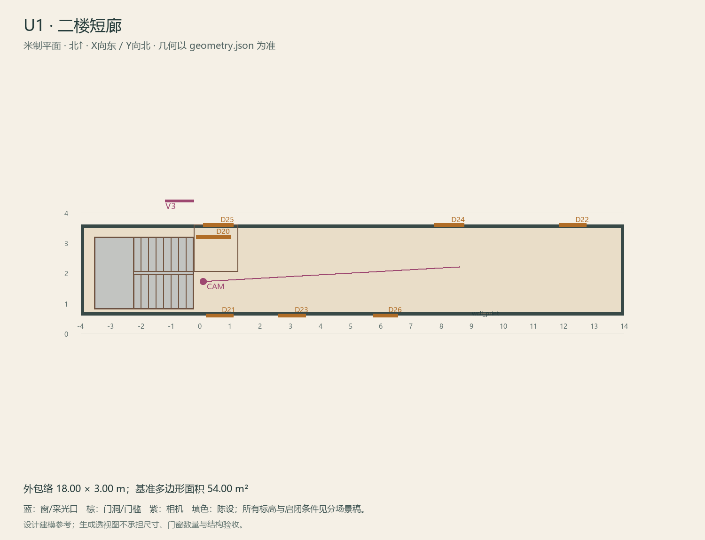

# U1 · 二楼短廊

ASSET-080 · 二层 · 第一夜建模参考，尚非已建成模型。

此节点暂无独立透视参考；以米制图和文字规格为准。

## 场景叙事与镜头

住宅尺度的短分配廊，深木房门、简单纸质房号、窄长地毯禁用以免遮地板锚点；外墙端有可辨院子方向的窗。

事件：A25/A30–A34。必须可读：二号门牌与院窗为双锚点；正常到S与绕行U5的关系不能靠鱼眼透视夸大；G重复门仅局部。

推荐构图：正常短廊轴向视图；补同镜头G局部错位对照。 透视图表达材质和氛围，下面的坐标与正交图控制建模。

## 精确结构

世界坐标 X 东/Y 北/Z 上，单位米。地坪 Z=3.6；净高参考 3.1；基准包络 18.00×3.00；多边形面积 54.00㎡。面积为基准线围合面积，净面积须按 geometry.json 的墙厚约定扣除。

基准顶点：`[[-4.0, 0.6], [14.0, 0.6], [14.0, 3.6], [-4.0, 3.6]]`。房间源对象原点：`[-4.0, 3.6, 3.6]`；禁止整体重置 Location。

门洞：

| 编号 | 相邻节点 | 门槛中心 XYZ | 净宽×高 | 沿轴 | 门禁 |
| --- | --- | --- | --- | --- | --- |
| D20 | S | [0.4, 3.2, 3.6] | 1.15×2.2 | X | always_open |
| D21 | U2 | [0.6, 0.6, 3.6] | 0.9×2.0 | X | order_unlocked |
| D22 | U3 | [12.3, 3.6, 3.6] | 0.9×2.0 | X | I2 |
| D23 | U4 | [3.0, 0.6, 3.6] | 0.9×2.0 | X | I2 |
| D24 | U5 | [8.2, 3.6, 3.6] | 1.0×2.1 | X | I2 |
| D25 | U6 | [0.55, 3.6, 3.6] | 1.0×2.1 | X | always_open |
| D26 | U7 | [6.1, 0.6, 3.6] | 0.8×2.0 | X | always_open |

窗/开口：

无独立外窗；不允许从透视图复制新增窗洞。

## 陈设与观察位

| 资产套件 | 尺寸 W/D/H | 底面中心 XYZ | Z旋转° | 碰撞 | 说明 |
| --- | --- | --- | --- | --- | --- |
| wall_print | [0.45, 0.03, 0.6] | [9.4, 0.66, 4.75] | 0 | False | 南墙挂画，避开U5/U7门和G双锚点。 |

相机：`{"position": [0.05, 1.72, 5.18], "target": [8.55, 2.2, 4.85], "lens_mm": 30}`。

通行检查：整条走廊无落地家具；U6-U8-U5绕行关系可见。

## 状态与制作分件

M：普通短廊；G：同构件复制一块门牌/门框与错误窗向，保存退回电话厅的可见门。

室内：灰米矿物抹灰、深棕木窗及踢脚、保养木地板；现代修补克制保留。 精确色值、材质粗糙度、贴图复用规则见 [visual-bible.md](../visual-bible.md)。

静态墙地顶、门窗框和普通陈设分集合制作；可动门扇、窗帘、锁、开关、抽屉、纸张、电话及手镜必须独立。关键道具尺寸、状态和操作见 [interaction-specs.md](../interaction-specs.md)。

Blender 保留高精度可编辑源，倒角按真实尺度制作，禁止把贴图阴影烘成唯一细节。优化导出单独生成；面数/贴图预算由实机性能复核，不能以占位模型冒充最终资产。完整交接见 [blender-handoff.md](../blender-handoff.md)。

## 此场景验收

- 逐一核对本页门窗与 geometry.json；检查墙厚、门扇扫掠区与上方梁底净空。
- 从相机位确认“必须可读”的道具与退路都可辨，普通装饰不得遮挡。
- 核对 M/W/G 只变化本页批准的局部；不引入额外通道。
- 建模完成后另验 UV、法线、贴图嵌入、碰撞与 目标引擎 运行；当前包不提供这些尚未发生的通过证据。

[返回总览](../index.html)
