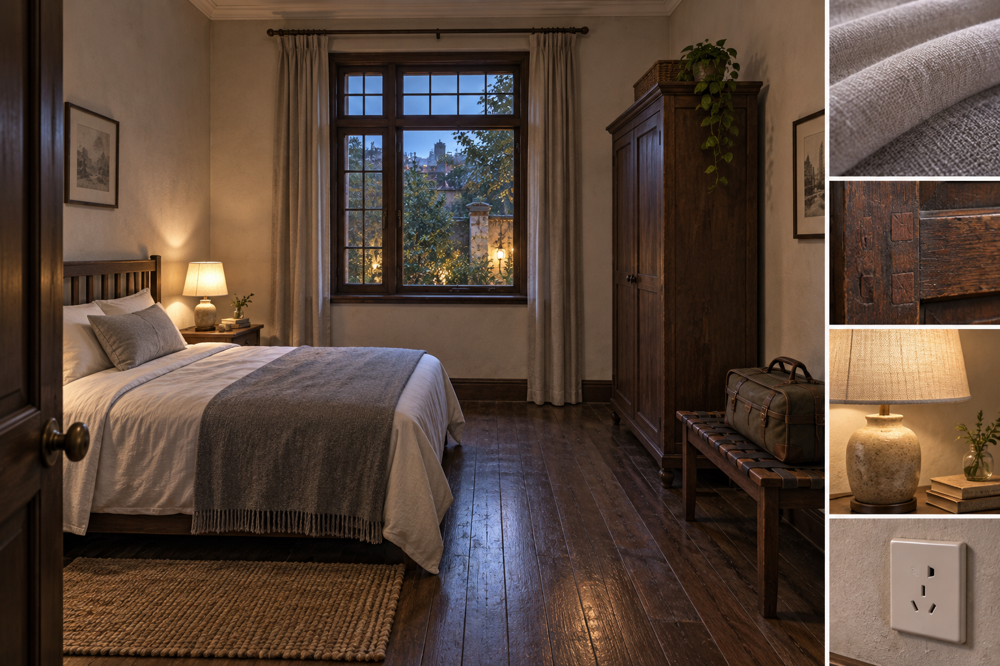
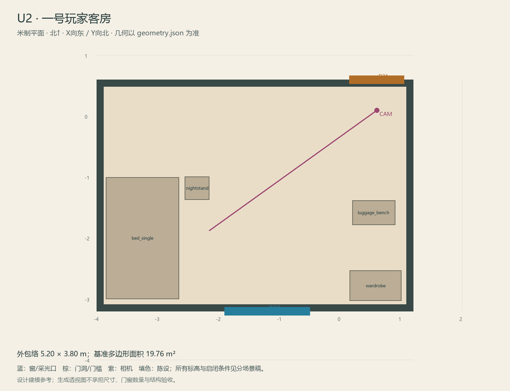

# U2 · 一号玩家客房

ASSET-081 · 二层 · 第一夜建模参考，尚非已建成模型。

## 场景叙事与镜头

干净的大单人客房，浅灰床品，旧木衣柜与翻新床架，行李凳和普通充电插座。南窗看向前院，清晨可与离开时的院景对应。

事件：A04/A06/A51。必须可读：床头灯、行李放置处、可看的窗；去浴室和回楼梯短路可读。

推荐构图：门内看床与窗，床品材质可读。 透视图表达材质和氛围，下面的坐标与正交图控制建模。

## 精确结构

世界坐标 X 东/Y 北/Z 上，单位米。地坪 Z=3.6；净高参考 3.1；基准包络 5.20×3.80；多边形面积 19.76㎡。面积为基准线围合面积，净面积须按 geometry.json 的墙厚约定扣除。

基准顶点：`[[-4.0, -3.2], [1.2, -3.2], [1.2, 0.6], [-4.0, 0.6]]`。房间源对象原点：`[-4.0, 0.6, 3.6]`；禁止整体重置 Location。

门洞：

| 编号 | 相邻节点 | 门槛中心 XYZ | 净宽×高 | 沿轴 | 门禁 |
| --- | --- | --- | --- | --- | --- |
| D21 | U1 | [0.6, 0.6, 3.6] | 0.9×2.0 | X | order_unlocked |

窗/开口：

| 编号 | 中心 XYZ | 宽×高 | 窗台 | 沿轴 | 视线目标 |
| --- | --- | --- | --- | --- | --- |
| W10 | [-1.2, -3.2, 4.975] | 1.4×1.35 | 0.7 | X | O1 |

## 陈设与观察位

| 资产套件 | 尺寸 W/D/H | 底面中心 XYZ | Z旋转° | 碰撞 | 说明 |
| --- | --- | --- | --- | --- | --- |
| bed_single | [1.2, 2.0, 0.55] | [-3.25, -2.0, 3.6] | 0 | True | 西侧床，床头灯靠北。 |
| nightstand | [0.4, 0.38, 0.52] | [-2.35, -1.18, 3.6] | 0 | True | 床头灯与休息交互位。 |
| wardrobe | [0.85, 0.5, 1.95] | [0.58, -2.78, 3.6] | 0 | True | 东南角衣柜。 |
| luggage_bench | [0.7, 0.4, 0.45] | [0.55, -1.58, 3.6] | 0 | True | 靠东墙，行李交互位朝西。 |

相机：`{"position": [0.6, 0.1, 5.2], "target": [-2.15, -1.88, 4.72], "lens_mm": 29}`。

通行检查：门口、床侧与窗前各保留0.8m以上路线。

## 状态与制作分件

M与真实清晨同骨架，只换自然光；无独有战时资产。

室内：灰米矿物抹灰、深棕木窗及踢脚、保养木地板；现代修补克制保留。 精确色值、材质粗糙度、贴图复用规则见 [visual-bible.md](../visual-bible.md)。

静态墙地顶、门窗框和普通陈设分集合制作；可动门扇、窗帘、锁、开关、抽屉、纸张、电话及手镜必须独立。关键道具尺寸、状态和操作见 [interaction-specs.md](../interaction-specs.md)。

Blender 保留高精度可编辑源，倒角按真实尺度制作，禁止把贴图阴影烘成唯一细节。优化导出单独生成；面数/贴图预算由实机性能复核，不能以占位模型冒充最终资产。完整交接见 [blender-handoff.md](../blender-handoff.md)。

## 此场景验收

- 逐一核对本页门窗与 geometry.json；检查墙厚、门扇扫掠区与上方梁底净空。
- 从相机位确认“必须可读”的道具与退路都可辨，普通装饰不得遮挡。
- 核对 M/W/G 只变化本页批准的局部；不引入额外通道。
- 建模完成后另验 UV、法线、贴图嵌入、碰撞与 目标引擎 运行；当前包不提供这些尚未发生的通过证据。

[返回总览](../index.html)
