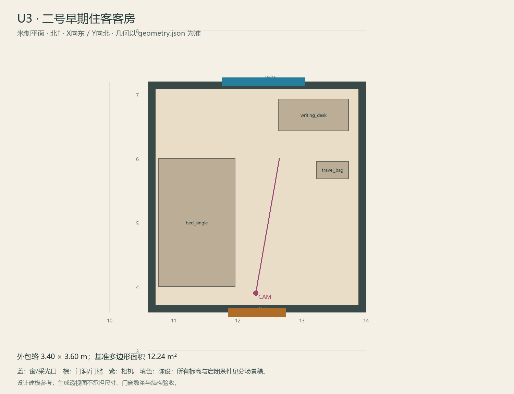

# U3 · 二号早期住客客房

ASSET-082 · 二层 · 第一夜建模参考，尚非已建成模型。

此节点暂无独立透视参考；以米制图和文字规格为准。

## 场景叙事与镜头

同一民宿客房套件，保留一张旧写字桌。较旧纸张收在桌面夹册与抽屉，门边旧路线铅笔线只局部可见；小旧旅行包靠桌。

事件：H2/D2/D3。必须可读：窗外O2方位可与图比较；桌上三稿线路、杯底干痕和未带走的旧包表现人的失序，不能变成凶案现场。

推荐构图：从门看桌、窗和保留空地；补记录/杯痕/旧包近景。 透视图表达材质和氛围，下面的坐标与正交图控制建模。

## 精确结构

世界坐标 X 东/Y 北/Z 上，单位米。地坪 Z=3.6；净高参考 3.1；基准包络 3.40×3.60；多边形面积 12.24㎡。面积为基准线围合面积，净面积须按 geometry.json 的墙厚约定扣除。

基准顶点：`[[10.6, 3.6], [14.0, 3.6], [14.0, 7.2], [10.6, 7.2]]`。房间源对象原点：`[10.6, 7.2, 3.6]`；禁止整体重置 Location。

门洞：

| 编号 | 相邻节点 | 门槛中心 XYZ | 净宽×高 | 沿轴 | 门禁 |
| --- | --- | --- | --- | --- | --- |
| D22 | U1 | [12.3, 3.6, 3.6] | 0.9×2.0 | X | I2 |

窗/开口：

| 编号 | 中心 XYZ | 宽×高 | 窗台 | 沿轴 | 视线目标 |
| --- | --- | --- | --- | --- | --- |
| W05 | [12.4, 7.2, 4.975] | 1.3×1.35 | 0.7 | X | O2 |

## 陈设与观察位

| 资产套件 | 尺寸 W/D/H | 底面中心 XYZ | Z旋转° | 碰撞 | 说明 |
| --- | --- | --- | --- | --- | --- |
| bed_single | [1.2, 2.0, 0.55] | [11.36, 5.0, 3.6] | 0 | True | 西侧床，门与窗视线不遮挡。 |
| writing_desk | [1.1, 0.5, 0.76] | [13.18, 6.68, 3.6] | 0 | True | 北侧桌，D2/D3纸张和杯痕在可见桌面。 |
| travel_bag | [0.5, 0.28, 0.38] | [13.48, 5.82, 3.6] | 0 | True | 靠东墙旧旅行包，非凶案陈设。 |

相机：`{"position": [12.28, 3.9, 5.18], "target": [12.65, 6.0, 4.78], "lens_mm": 30}`。

通行检查：门到桌前与窗前保持0.90m；记录阅读位不挤床边。

## 状态与制作分件

M为可查旧物的现状；只需局部显影贴花，不制作住客人形。

室内：灰米矿物抹灰、深棕木窗及踢脚、保养木地板；现代修补克制保留。 精确色值、材质粗糙度、贴图复用规则见 [visual-bible.md](../visual-bible.md)。

静态墙地顶、门窗框和普通陈设分集合制作；可动门扇、窗帘、锁、开关、抽屉、纸张、电话及手镜必须独立。关键道具尺寸、状态和操作见 [interaction-specs.md](../interaction-specs.md)。

Blender 保留高精度可编辑源，倒角按真实尺度制作，禁止把贴图阴影烘成唯一细节。优化导出单独生成；面数/贴图预算由实机性能复核，不能以占位模型冒充最终资产。完整交接见 [blender-handoff.md](../blender-handoff.md)。

## 此场景验收

- 逐一核对本页门窗与 geometry.json；检查墙厚、门扇扫掠区与上方梁底净空。
- 从相机位确认“必须可读”的道具与退路都可辨，普通装饰不得遮挡。
- 核对 M/W/G 只变化本页批准的局部；不引入额外通道。
- 建模完成后另验 UV、法线、贴图嵌入、碰撞与 目标引擎 运行；当前包不提供这些尚未发生的通过证据。

[返回总览](../index.html)
