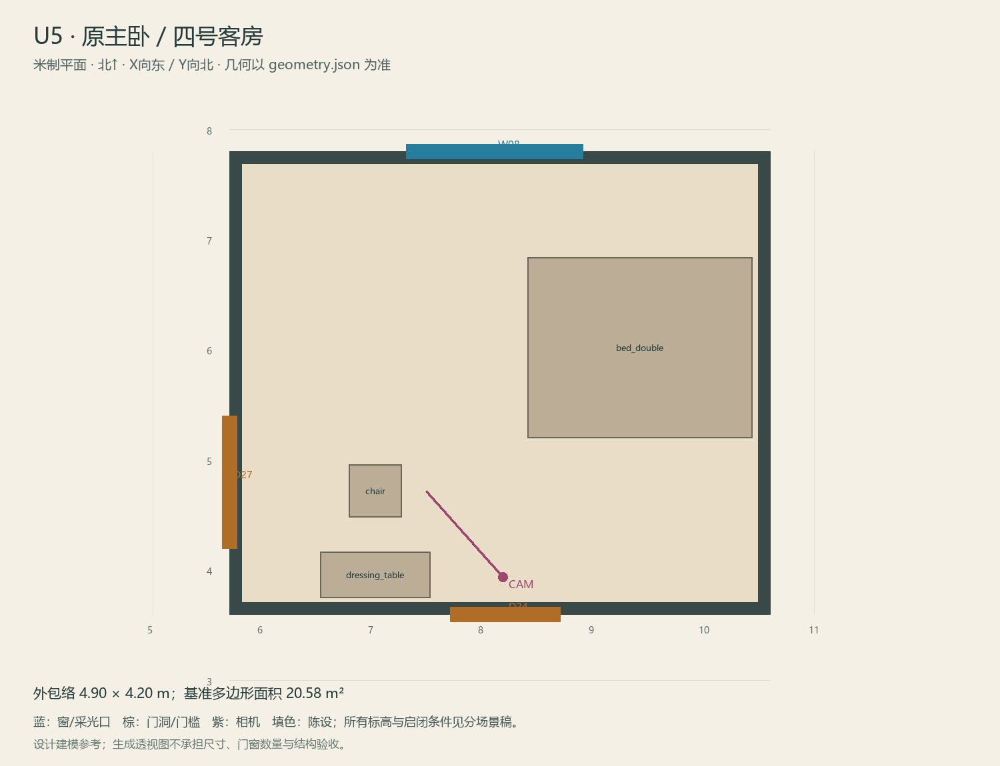

# U5 · 原主卧／四号客房

ASSET-084 · 二层 · 第一夜建模参考，尚非已建成模型。

此节点暂无独立透视参考；以米制图和文字规格为准。

## 场景叙事与镜头

略宽的旧主卧，保留深木床架与小梳妆台，现代床品克制。梳妆台不配巨大落地镜，只保留可放手镜的旧托位。

事件：A33/H5/V2。必须可读：U1与U8两个正常门；V2镜中旧门对应现实完整外墙，绝不能在正常M模型里开第三扇门。

推荐构图：从短廊入口看梳妆台与阳台门；补手镜托位和旧门/实体墙对照。 透视图表达材质和氛围，下面的坐标与正交图控制建模。

## 精确结构

世界坐标 X 东/Y 北/Z 上，单位米。地坪 Z=3.6；净高参考 3.1；基准包络 4.90×4.20；多边形面积 20.58㎡。面积为基准线围合面积，净面积须按 geometry.json 的墙厚约定扣除。

基准顶点：`[[5.7, 3.6], [10.6, 3.6], [10.6, 7.8], [5.7, 7.8]]`。房间源对象原点：`[5.7, 7.8, 3.6]`；禁止整体重置 Location。

门洞：

| 编号 | 相邻节点 | 门槛中心 XYZ | 净宽×高 | 沿轴 | 门禁 |
| --- | --- | --- | --- | --- | --- |
| D24 | U1 | [8.2, 3.6, 3.6] | 1.0×2.1 | X | I2 |
| D27 | U8 | [5.7, 4.8, 3.6] | 1.2×2.2 | Y | I2 |

窗/开口：

| 编号 | 中心 XYZ | 宽×高 | 窗台 | 沿轴 | 视线目标 |
| --- | --- | --- | --- | --- | --- |
| W08 | [8.1, 7.8, 5.025] | 1.6×1.45 | 0.7 | X | O2 |

## 陈设与观察位

| 资产套件 | 尺寸 W/D/H | 底面中心 XYZ | Z旋转° | 碰撞 | 说明 |
| --- | --- | --- | --- | --- | --- |
| bed_double | [1.65, 2.05, 0.58] | [9.42, 6.02, 3.6] | 90 | True | 东侧双人床，避免U1门和U8阳台门。 |
| dressing_table | [1.0, 0.42, 0.78] | [7.02, 3.96, 3.6] | 0 | True | 南墙梳妆台，手镜托位靠后缘。 |
| chair | [0.48, 0.48, 0.85] | [7.02, 4.72, 3.6] | 0 | True | 朝南，镜中旧门对照的前站位。 |

相机：`{"position": [8.18, 3.94, 5.2], "target": [7.48, 4.72, 4.75], "lens_mm": 30}`。

通行检查：U1门、阳台门、梳妆台之间均有0.9m以上可绕路线。

## 状态与制作分件

M：现代床品、旧台与完整墙；镜景W：空椅、遮光布、过去的窄门；G残影仅平面参考。

室内：灰米矿物抹灰、深棕木窗及踢脚、保养木地板；现代修补克制保留。 精确色值、材质粗糙度、贴图复用规则见 [visual-bible.md](../visual-bible.md)。

静态墙地顶、门窗框和普通陈设分集合制作；可动门扇、窗帘、锁、开关、抽屉、纸张、电话及手镜必须独立。关键道具尺寸、状态和操作见 [interaction-specs.md](../interaction-specs.md)。

Blender 保留高精度可编辑源，倒角按真实尺度制作，禁止把贴图阴影烘成唯一细节。优化导出单独生成；面数/贴图预算由实机性能复核，不能以占位模型冒充最终资产。完整交接见 [blender-handoff.md](../blender-handoff.md)。

## 此场景验收

- 逐一核对本页门窗与 geometry.json；检查墙厚、门扇扫掠区与上方梁底净空。
- 从相机位确认“必须可读”的道具与退路都可辨，普通装饰不得遮挡。
- 核对 M/W/G 只变化本页批准的局部；不引入额外通道。
- 建模完成后另验 UV、法线、贴图嵌入、碰撞与 目标引擎 运行；当前包不提供这些尚未发生的通过证据。

[返回总览](../index.html)
