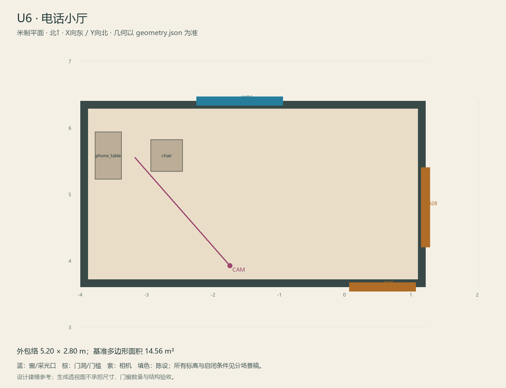

# U6 · 电话小厅

ASSET-085 · 二层 · 第一夜建模参考，尚非已建成模型。

此节点暂无独立透视参考；以米制图和文字规格为准。

## 场景叙事与镜头

小家庭起居角，一张旧电话桌、木椅、分格木窗。电话是画面重点，桌边杯碟提供可见同步线索，不搭建接待大厅。

事件：A26–A30。必须可读：通U1和U8；能看后院方向；电话、听筒、铃盒/可见震动件与杯碟分开。

推荐构图：入口看电话桌与窗；补电话/杯碟作为声源证据。 透视图表达材质和氛围，下面的坐标与正交图控制建模。

## 精确结构

世界坐标 X 东/Y 北/Z 上，单位米。地坪 Z=3.6；净高参考 3.1；基准包络 5.20×2.80；多边形面积 14.56㎡。面积为基准线围合面积，净面积须按 geometry.json 的墙厚约定扣除。

基准顶点：`[[-4.0, 3.6], [1.2, 3.6], [1.2, 6.4], [-4.0, 6.4]]`。房间源对象原点：`[-4.0, 6.4, 3.6]`；禁止整体重置 Location。

门洞：

| 编号 | 相邻节点 | 门槛中心 XYZ | 净宽×高 | 沿轴 | 门禁 |
| --- | --- | --- | --- | --- | --- |
| D25 | U1 | [0.55, 3.6, 3.6] | 1.0×2.1 | X | always_open |
| D28 | U8 | [1.2, 4.8, 3.6] | 1.2×2.2 | Y | always_open |

窗/开口：

| 编号 | 中心 XYZ | 宽×高 | 窗台 | 沿轴 | 视线目标 |
| --- | --- | --- | --- | --- | --- |
| W06 | [-1.6, 6.4, 4.975] | 1.3×1.35 | 0.7 | X | O2 |

## 陈设与观察位

| 资产套件 | 尺寸 W/D/H | 底面中心 XYZ | Z旋转° | 碰撞 | 说明 |
| --- | --- | --- | --- | --- | --- |
| phone_table | [0.72, 0.4, 0.75] | [-3.58, 5.58, 3.6] | 90 | True | 西墙电话桌，电话/铃锤/杯碟为独立动态证据。 |
| chair | [0.48, 0.48, 0.85] | [-2.7, 5.58, 3.6] | 0 | True | 朝西坐椅，留出听电话和退回U1的路线。 |

相机：`{"position": [-1.75, 3.92, 5.18], "target": [-3.18, 5.55, 4.73], "lens_mm": 31}`。

通行检查：U1与U8出口可同时看见；电话前净宽1.0m。

## 状态与制作分件

M：保留的旧电话陈设；W仅桌面生活片段；G声音副本发生在U1而非另加电话。

室内：灰米矿物抹灰、深棕木窗及踢脚、保养木地板；现代修补克制保留。 精确色值、材质粗糙度、贴图复用规则见 [visual-bible.md](../visual-bible.md)。

静态墙地顶、门窗框和普通陈设分集合制作；可动门扇、窗帘、锁、开关、抽屉、纸张、电话及手镜必须独立。关键道具尺寸、状态和操作见 [interaction-specs.md](../interaction-specs.md)。

Blender 保留高精度可编辑源，倒角按真实尺度制作，禁止把贴图阴影烘成唯一细节。优化导出单独生成；面数/贴图预算由实机性能复核，不能以占位模型冒充最终资产。完整交接见 [blender-handoff.md](../blender-handoff.md)。

## 此场景验收

- 逐一核对本页门窗与 geometry.json；检查墙厚、门扇扫掠区与上方梁底净空。
- 从相机位确认“必须可读”的道具与退路都可辨，普通装饰不得遮挡。
- 核对 M/W/G 只变化本页批准的局部；不引入额外通道。
- 建模完成后另验 UV、法线、贴图嵌入、碰撞与 目标引擎 运行；当前包不提供这些尚未发生的通过证据。

[返回总览](../index.html)
