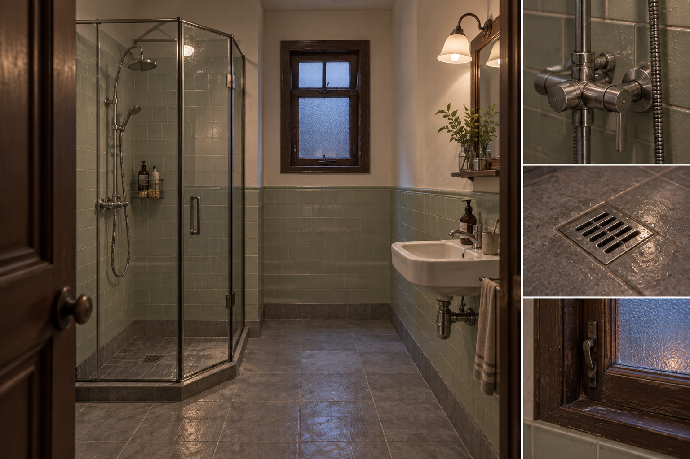
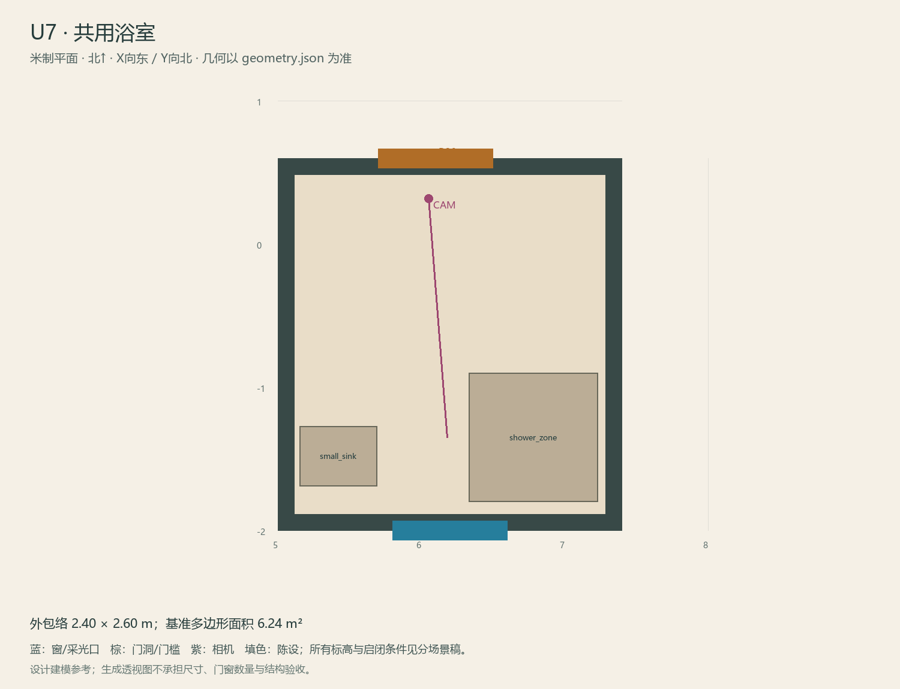

# U7 · 共用浴室

ASSET-086 · 二层 · 第一夜建模参考，尚非已建成模型。

## 场景叙事与镜头

紧凑淋浴间，南侧为白灰小砖的磨砂玻璃淋浴屏，西侧为小洗手台和普通热水管线。新龙头与旧门框形成翻修层次。

事件：A05/A07。必须可读：试水点易靠近，湿区不侵占门口，热水故障只做声音/指示变化。

推荐构图：门洞看淋浴和龙头，材质中性不反光过曝。 透视图表达材质和氛围，下面的坐标与正交图控制建模。

## 精确结构

世界坐标 X 东/Y 北/Z 上，单位米。地坪 Z=3.6；净高参考 3.0；基准包络 2.40×2.60；多边形面积 6.24㎡。面积为基准线围合面积，净面积须按 geometry.json 的墙厚约定扣除。

基准顶点：`[[5.0, -2.0], [7.4, -2.0], [7.4, 0.6], [5.0, 0.6]]`。房间源对象原点：`[5.0, 0.6, 3.6]`；禁止整体重置 Location。

门洞：

| 编号 | 相邻节点 | 门槛中心 XYZ | 净宽×高 | 沿轴 | 门禁 |
| --- | --- | --- | --- | --- | --- |
| D26 | U1 | [6.1, 0.6, 3.6] | 0.8×2.0 | X | always_open |

窗/开口：

| 编号 | 中心 XYZ | 宽×高 | 窗台 | 沿轴 | 视线目标 |
| --- | --- | --- | --- | --- | --- |
| W13 | [6.2, -2.0, 5.575] | 0.8×0.65 | 1.65 | X | O1 |

## 陈设与观察位

| 资产套件 | 尺寸 W/D/H | 底面中心 XYZ | Z旋转° | 碰撞 | 说明 |
| --- | --- | --- | --- | --- | --- |
| shower_zone | [0.9, 0.9, 2.1] | [6.78, -1.35, 3.6] | 0 | True | 南侧淋浴区，磨砂屏独立但静态。 |
| small_sink | [0.55, 0.42, 0.85] | [5.42, -1.48, 3.6] | 0 | True | 西墙洗手台，热水试水点。 |

相机：`{"position": [6.05, 0.32, 5.16], "target": [6.18, -1.35, 4.7], "lens_mm": 32}`。

通行检查：门口到淋浴/洗手台之间保持0.8m净宽。

## 状态与制作分件

仅M，不做大量水模拟。

湿区：灰绿釉面砖/矿物防滑地砖、白陶瓷、拉丝或镀铬五金。 精确色值、材质粗糙度、贴图复用规则见 [visual-bible.md](../visual-bible.md)。

静态墙地顶、门窗框和普通陈设分集合制作；可动门扇、窗帘、锁、开关、抽屉、纸张、电话及手镜必须独立。关键道具尺寸、状态和操作见 [interaction-specs.md](../interaction-specs.md)。

Blender 保留高精度可编辑源，倒角按真实尺度制作，禁止把贴图阴影烘成唯一细节。优化导出单独生成；面数/贴图预算由实机性能复核，不能以占位模型冒充最终资产。完整交接见 [blender-handoff.md](../blender-handoff.md)。

## 此场景验收

- 逐一核对本页门窗与 geometry.json；检查墙厚、门扇扫掠区与上方梁底净空。
- 从相机位确认“必须可读”的道具与退路都可辨，普通装饰不得遮挡。
- 核对 M/W/G 只变化本页批准的局部；不引入额外通道。
- 建模完成后另验 UV、法线、贴图嵌入、碰撞与 目标引擎 运行；当前包不提供这些尚未发生的通过证据。

[返回总览](../index.html)
