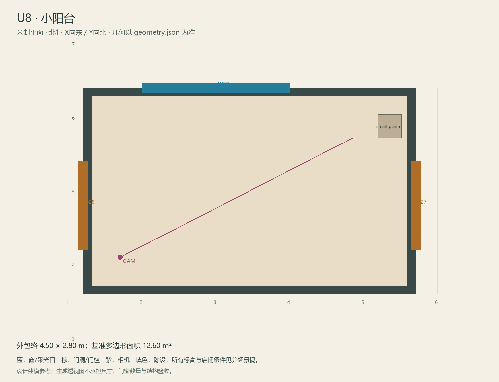

# U8 · 小阳台

ASSET-087 · 二层 · 第一夜建模参考，尚非已建成模型。

此节点暂无独立透视参考；以米制图和文字规格为准。

## 场景叙事与镜头

小型连通阳台，深色细铁栏杆，浅灰防滑地面，两端是电话厅和原主卧的门。仅一只花盆靠边。

事件：A33绕行。必须可读：通行净宽与两个门扇都保留；望向后院晾衣杆与厨房窗；不可添加室外楼梯。

推荐构图：从电话厅门看原主卧方向及栏杆外院子。 透视图表达材质和氛围，下面的坐标与正交图控制建模。

## 精确结构

世界坐标 X 东/Y 北/Z 上，单位米。地坪 Z=3.6；净高参考 3.1；基准包络 4.50×2.80；多边形面积 12.60㎡。面积为基准线围合面积，净面积须按 geometry.json 的墙厚约定扣除。

基准顶点：`[[1.2, 3.6], [5.7, 3.6], [5.7, 6.4], [1.2, 6.4]]`。房间源对象原点：`[1.2, 6.4, 3.6]`；禁止整体重置 Location。

门洞：

| 编号 | 相邻节点 | 门槛中心 XYZ | 净宽×高 | 沿轴 | 门禁 |
| --- | --- | --- | --- | --- | --- |
| D27 | U5 | [5.7, 4.8, 3.6] | 1.2×2.2 | Y | I2 |
| D28 | U6 | [1.2, 4.8, 3.6] | 1.2×2.2 | Y | always_open |

窗/开口：

| 编号 | 中心 XYZ | 宽×高 | 窗台 | 沿轴 | 视线目标 |
| --- | --- | --- | --- | --- | --- |
| W07 | [3.0, 6.4, 4.95] | 2.0×1.6 | 0.55 | X | O2 |

## 陈设与观察位

| 资产套件 | 尺寸 W/D/H | 底面中心 XYZ | Z旋转° | 碰撞 | 说明 |
| --- | --- | --- | --- | --- | --- |
| small_planter | [0.32, 0.32, 0.42] | [5.35, 5.88, 3.6] | 0 | True | 东侧栏边小花箱，不挡U5门。 |

相机：`{"position": [1.7, 4.1, 5.15], "target": [4.85, 5.72, 4.75], "lens_mm": 28}`。

通行检查：阳台通行面连续，后院树、窗和U5门均可读。

## 状态与制作分件

M清晰基线；不另建W阳台。

室内：灰米矿物抹灰、深棕木窗及踢脚、保养木地板；现代修补克制保留。 精确色值、材质粗糙度、贴图复用规则见 [visual-bible.md](../visual-bible.md)。

静态墙地顶、门窗框和普通陈设分集合制作；可动门扇、窗帘、锁、开关、抽屉、纸张、电话及手镜必须独立。关键道具尺寸、状态和操作见 [interaction-specs.md](../interaction-specs.md)。

Blender 保留高精度可编辑源，倒角按真实尺度制作，禁止把贴图阴影烘成唯一细节。优化导出单独生成；面数/贴图预算由实机性能复核，不能以占位模型冒充最终资产。完整交接见 [blender-handoff.md](../blender-handoff.md)。

## 此场景验收

- 逐一核对本页门窗与 geometry.json；检查墙厚、门扇扫掠区与上方梁底净空。
- 从相机位确认“必须可读”的道具与退路都可辨，普通装饰不得遮挡。
- 核对 M/W/G 只变化本页批准的局部；不引入额外通道。
- 建模完成后另验 UV、法线、贴图嵌入、碰撞与 目标引擎 运行；当前包不提供这些尚未发生的通过证据。

[返回总览](../index.html)
